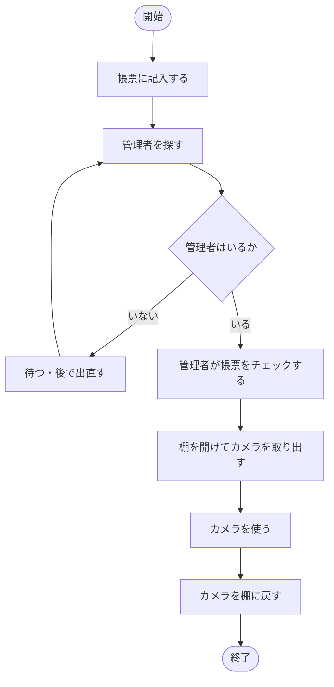
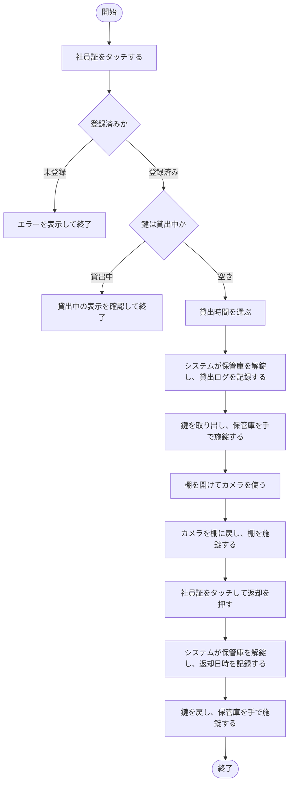
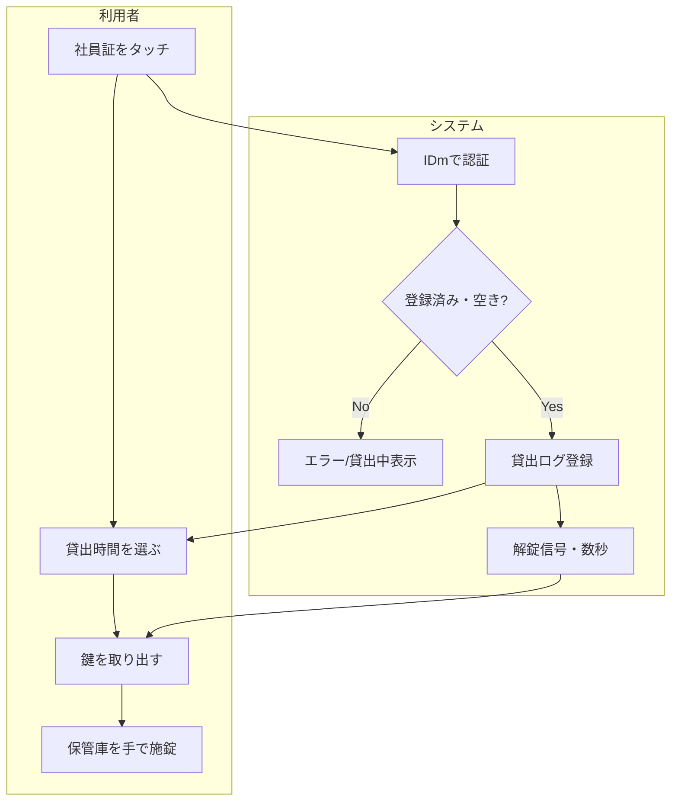

# 業務フロー定義

| 項目 | 内容 |
|------|------|
| 文書種別 | 業務フロー定義（As-Is / To-Be） |
| バージョン | 1.0 |
| 作成日 | 2026-11-05 |

改善後は管理者がフローから外れ、利用者だけで貸出から返却まで完結します。帳票の記入と管理者チェックがなくなり、記録がシステムに置き換わる点が最大の変化です。

---

## 1. 現状（As-Is）

### 現状の問題点（対応課題）

| 箇所 | 問題 | 課題ID |
|------|------|--------|
| 帳票に記入する | 記入が面倒で形骸化する | ISS-1 |
| 管理者を探す／いるか | 管理者不在で貸出できない、探す手間 | ISS-2, ISS-3 |

## 2. 改善後（To-Be）

## 3. As-Is / To-Be 比較

| 観点 | As-Is | To-Be | 効果 |
|------|-------|-------|------|
| 本人確認 | 帳票への手書き | 社員証タッチ（IDm） | 手間削減・確実化 |
| 承認 | 管理者が帳票チェック | 省略（登録メンバーに限定） | 待ち時間ゼロ |
| 記録 | 紙帳票 | 貸借ログ（DB）→CSV | 追跡性・移行容易 |
| 解錠 | 管理者が棚を開ける | システムが保管庫を解錠 | 管理者不要 |
| 施錠 | 人手 | 人手（変更なし） | — |
| 状況把握 | なし | 待機画面に貸出中表示 | 待ち判断が可能 |

## 4. アクティビティ図（担当分担：貸出）

## 5. 例外・異常フロー

| 状況 | システムの振る舞い | 利用者の対応 |
|------|-------------------|-------------|
| 未登録カード | エラー表示（S06）→待機画面へ | 管理者に登録を依頼 |
| すでに貸出中 | 貸出中表示（氏名・返却予定） | 返却を待つ／状況確認 |
| 本人以外が返却操作 | エラー表示（運用方針次第、[10] Q6） | 本人へ連絡 |
| 返却予定を超過 | 待機画面で延滞強調（FR-09）、通知はP2 | 速やかに返却 |
| 停電・システム故障 | 解錠不可 | 予備鍵で対応（[10] Q7） |
