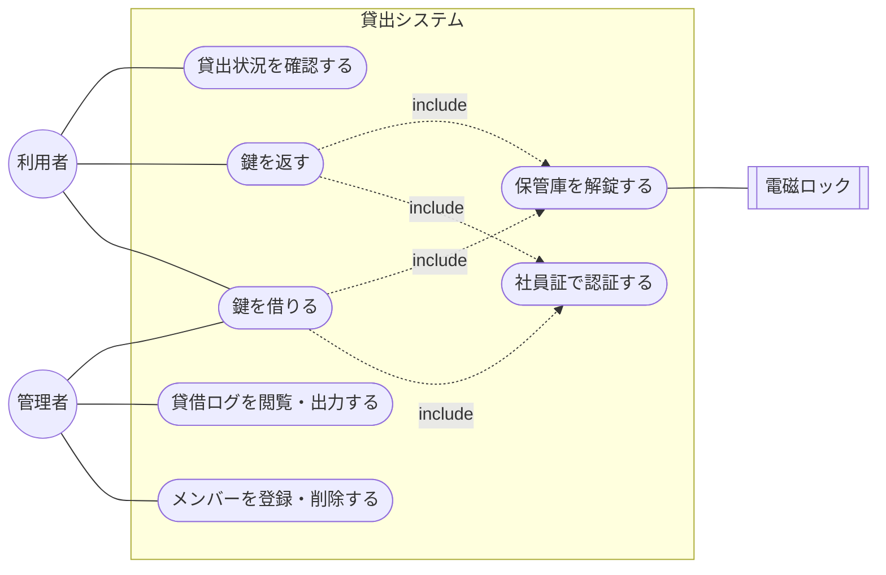

# ユースケース定義

| 項目 | 内容 |
|------|------|
| 文書種別 | ユースケース図・ユースケース記述 |
| バージョン | 1.0 |
| 作成日 | 2026-11-05 |

利用者のユースケースは「借りる」「返す」「状況を見る」の3つ、管理者は登録とログ確認を担当します。

---

## 1. ユースケース図

## 2. ユースケース一覧

| ID | ユースケース | アクター | 概要 | 対応要件 |
|----|------------|---------|------|----------|
| UC1 | 社員証で認証する | 利用者・管理者 | IDm を読み取り、登録メンバーか判定する | FR-01, FR-08 |
| UC2 | 鍵を借りる | 利用者・管理者 | 貸出時間を選び、解錠して貸出ログを記録する | FR-02 |
| UC3 | 鍵を返す | 利用者・管理者 | 解錠して返却日時を記録する | FR-03 |
| UC4 | 貸出状況を確認する | 利用者 | 貸出中の人と返却予定時刻を見る | FR-04, FR-09 |
| UC5 | メンバーを登録・削除する | 管理者 | 社員証と氏名・社員番号をひも付ける | FR-06 |
| UC6 | 貸借ログを閲覧・出力する | 管理者 | 帳票の代わりとして CSV 出力する | FR-07, FR-12 |
| UC7 | 保管庫を解錠する | システム | ソレノイドに数秒通電する | FR-05 |

管理者自身の貸出も UC2 で扱う想定（[10] Q6 で確認）。

---

## 3. ユースケース記述

### UC2 鍵を借りる

| 項目 | 内容 |
|------|------|
| アクター | 利用者（または管理者） |
| 目的 | セキュアカメラ棚の鍵を借りる |
| 事前条件 | アクターが登録メンバーである／鍵が空いている |
| 事後条件 | 貸借ログに貸出が記録され、保管庫が解錠される |
| トリガー | 待機画面で社員証をタッチする |

**基本フロー**
1. アクターが社員証をタッチする
2. システムが IDm を読み取り、登録メンバーか照合する（include UC1）
3. システムが鍵の空き状況を確認する
4. 空いているので貸出時間選択画面を表示する
5. アクターが貸出時間を選ぶ
6. システムが貸出ログを登録する（貸出日時・貸出時間・返却予定）
7. システムが保管庫を解錠する（include UC7）
8. 「鍵を取り出してください」を表示する
9. アクターが鍵を取り出し、保管庫を手で施錠する

**代替・例外フロー**
- 2a. 未登録：エラー表示して待機画面へ戻る
- 3a. 貸出中：貸出中（氏名・返却予定）を表示して終了
- 5a. 無操作タイムアウト：待機画面へ戻る

### UC3 鍵を返す

| 項目 | 内容 |
|------|------|
| アクター | 利用者（または管理者） |
| 目的 | 借りた鍵を返却する |
| 事前条件 | 当該アクターの貸出中ログが存在する |
| 事後条件 | 返却日時が記録され、保管庫が解錠される |
| トリガー | 待機画面で社員証をタッチする |

**基本フロー**
1. アクターが社員証をタッチする
2. システムが IDm を読み取る（include UC1）
3. システムが「貸出中かつ本人」の貸出を検索する
4. 該当あり → 返却確認画面を表示する
5. アクターが「返却する」を押す
6. システムが返却日時を記録する
7. システムが保管庫を解錠する（include UC7）
8. 「鍵を戻してください」を表示する
9. アクターが鍵を戻し、保管庫を手で施錠する

**代替・例外フロー**
- 3a. 本人の貸出でない：エラー表示（本人以外の返却可否は [10] Q6）

### UC1 社員証で認証する（include）

| 項目 | 内容 |
|------|------|
| アクター | 利用者・管理者 |
| 事前条件 | カードリーダーが動作している |
| 事後条件 | メンバー情報（氏名・社員番号・ロール）が特定される、または未登録と判定される |

**基本フロー**
1. カードリーダーが IDm を取得する
2. システムが MEMBER を照合する（`is_active = true`）
3. 一致 → メンバー情報を返す／不一致 → 未登録として返す

### UC5 メンバーを登録・削除する

| 項目 | 内容 |
|------|------|
| アクター | 管理者 |
| 事前条件 | 管理者として認証済み（管理メニュー内） |
| 事後条件 | メンバーが追加／無効化／削除される |

**基本フロー**
1. 管理メニューからメンバー管理を開く
2. 新規登録：社員証タッチで IDm 取得 → 氏名・社員番号・ロール入力 → 保存
3. 無効化：対象メンバーを選び `is_active = false` にする

### UC6 貸借ログを閲覧・出力する

| 項目 | 内容 |
|------|------|
| アクター | 管理者 |
| 事前条件 | 管理者として認証済み |
| 事後条件 | 期間分の貸借ログが CSV として出力される |

**基本フロー**
1. 管理メニューからログ出力を開く
2. 期間を指定する
3. CSV を書き出す（USBメモリ等）

### UC7 保管庫を解錠する（include）

| 項目 | 内容 |
|------|------|
| アクター | システム |
| 事前条件 | 貸出または返却の記録が確定している |
| 事後条件 | ソレノイドへ数秒通電し、その後 OFF に戻る |

**基本フロー**
1. GPIO 出力でロック駆動回路を ON にする
2. 規定秒数待つ
3. GPIO 出力を OFF に戻す
