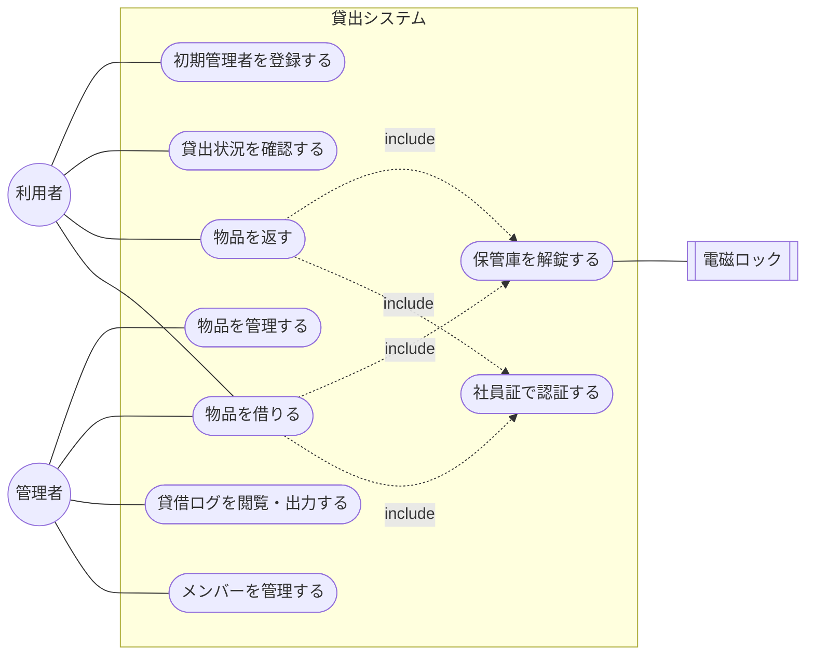

# ユースケース定義

| 項目 | 内容 |
|------|------|
| 文書種別 | ユースケース図・ユースケース記述 |
| バージョン | 1.1 |
| 作成日 | 2026-11-05（更新: 2026-11-16） |

利用者のユースケースは「借りる」「返す」「状況を見る」の3つ、管理者は登録とログ確認を担当します。

---

## 1. ユースケース図

## 2. ユースケース一覧

| ID | ユースケース | アクター | 概要 | 対応要件 |
|----|------------|---------|------|----------|
| UC1 | 社員証で認証する | 利用者・管理者 | IDm を読み取り、登録メンバーか判定する | FR-01, FR-08 |
| UC2 | 物品を借りる | 利用者・管理者 | 物品（複数あれば選択）・貸出時間を選び、解錠して貸出ログを記録する | FR-02, FR-11 |
| UC3 | 物品を返す | 利用者・管理者 | 本人の未返却（複数あれば選択）を解錠して返却日時を記録する | FR-03, FR-11 |
| UC4 | 貸出状況を確認する | 利用者 | 全物品の貸出中の人と返却予定時刻を見る | FR-04, FR-09, FR-11 |
| UC5 | メンバーを管理する | 管理者 | 社員証と氏名・社員番号をひも付けて登録し、ロール変更・編集・カード再発行・無効化を行う | FR-06, FR-14 |
| UC6 | 貸借ログを閲覧・出力する | 管理者 | 帳票の代わりとして CSV 出力する | FR-07, FR-12 |
| UC7 | 保管庫を解錠する | システム | ソレノイドに数秒通電する | FR-05 |
| UC8 | 初期管理者を登録する | 利用者（カード所持者） | 有効な管理者が0人のときに限り、未登録カードのタッチから自分を管理者として登録する | FR-13 |
| UC9 | 物品を管理する | 管理者 | 物品の追加・名称/保管場所の編集・有効化/無効化を行う | FR-15 |

管理者自身の貸出も UC2 で扱う想定（[10] Q6 で確認）。

---

## 3. ユースケース記述

### UC2 物品を借りる

| 項目 | 内容 |
|------|------|
| アクター | 利用者（または管理者） |
| 目的 | 物品（鍵）を借りる |
| 事前条件 | アクターが登録メンバーである／空いている物品が1件以上ある |
| 事後条件 | 貸借ログに貸出が記録され、保管庫が解錠される |
| トリガー | 待機画面で社員証をタッチする |

**基本フロー**
1. アクターが社員証をタッチする
2. システムが IDm を読み取り、登録メンバーか照合する（include UC1）
3. システムが空いている物品の件数を確認する
4. 空きが複数件なら物品選択画面（borrow_item）を表示し、アクターが物品を選ぶ。空きが1件のみなら自動でスキップする
5. 貸出時間選択画面を表示する
6. アクターが貸出時間を選ぶ
7. システムが貸出ログを登録する（貸出日時・物品・貸出時間・返却予定）
8. システムが保管庫を解錠する（include UC7）
9. 「鍵を取り出してください」を表示する
10. アクターが鍵を取り出し、保管庫を手で施錠する

**代替・例外フロー**
- 2a. 未登録：有効な管理者が0人ならセットアップ画面へ（UC8）、それ以外はエラー表示して待機画面へ戻る
- 3a. 空いている物品が0件：「空いている物品がありません」を表示して終了
- 6a. 無操作タイムアウト：待機画面へ戻る

### UC3 物品を返す

| 項目 | 内容 |
|------|------|
| アクター | 利用者（または管理者） |
| 目的 | 借りた物品（鍵）を返却する |
| 事前条件 | 当該アクターの貸出中ログが1件以上存在する |
| 事後条件 | 返却日時が記録され、保管庫が解錠される |
| トリガー | 待機画面で社員証をタッチする |

**基本フロー**
1. アクターが社員証をタッチする
2. システムが IDm を読み取る（include UC1）
3. システムが「貸出中かつ本人」の貸出を検索する（複数物品を借りていれば複数件になり得る）
4. 該当が1件 → 返却確認画面を直接表示する。複数件 → 返却選択画面（return_select）で対象を選ばせ、返却確認画面へ進む
5. アクターが「返却する」を押す（または「借りる」でUC2へ切り替える）
6. システムが返却日時を記録する
7. システムが保管庫を解錠する（include UC7）
8. 「鍵を戻してください」を表示する
9. アクターが鍵を戻し、保管庫を手で施錠する

**代替・例外フロー**
- 3a. 本人の貸出でない：エラー表示（本人以外の返却可否は [10] Q6）

### UC1 社員証で認証する（include）

| 項目 | 内容 |
|------|------|
| アクター | 利用者・管理者 |
| 事前条件 | カードリーダーが動作している |
| 事後条件 | メンバー情報（氏名・社員番号・ロール）が特定される、または未登録と判定される |

**基本フロー**
1. カードリーダーが IDm を取得する
2. システムが MEMBER を照合する（`is_active = true`）
3. 一致 → メンバー情報を返す／不一致 → 未登録として返す

### UC5 メンバーを管理する

| 項目 | 内容 |
|------|------|
| アクター | 管理者 |
| 事前条件 | 管理者として認証済み（管理メニュー内） |
| 事後条件 | メンバーが追加／編集／ロール変更／カード再発行／無効化・再有効化される |

**基本フロー**
1. 管理メニューからメンバー管理（A02）を開く
2. 新規登録：社員証タッチで IDm 取得 → 氏名・社員番号・ロール入力 → 保存
3. 編集：対象メンバーを選び、氏名・社員番号を更新する（FR-14）
4. ロール変更：対象メンバーの user↔admin を切り替える（FR-14）
5. カード再発行：対象メンバーを「カード待ち」にし、次のタッチのIDmへ付け替える（FR-14）
6. 無効化／再有効化：対象メンバーの `is_active` を切り替える

**代替・例外フロー**
- 3a〜6a. 対象が最後の有効な管理者：無効化・user への降格・削除を拒否する（FR-14）
- 5a. 再発行先のIDmが既に他メンバーに登録済み：エラー表示

### UC6 貸借ログを閲覧・出力する

| 項目 | 内容 |
|------|------|
| アクター | 管理者 |
| 事前条件 | 管理者として認証済み |
| 事後条件 | 期間分の貸借ログが CSV として出力される |

**基本フロー**
1. 管理メニューからログ出力を開く
2. 期間を指定する
3. CSV を書き出す（USBメモリ等）

### UC7 保管庫を解錠する（include）

| 項目 | 内容 |
|------|------|
| アクター | システム |
| 事前条件 | 貸出または返却の記録が確定している |
| 事後条件 | ソレノイドへ数秒通電し、その後 OFF に戻る |

**基本フロー**
1. GPIO 出力でロック駆動回路を ON にする
2. 規定秒数待つ
3. GPIO 出力を OFF に戻す

### UC8 初期管理者を登録する

| 項目 | 内容 |
|------|------|
| アクター | 利用者（カード所持者） |
| 目的 | 管理者が1人もいない状態（鶏卵問題）を解消する |
| 事前条件 | 有効な管理者（`role='admin'` かつ `is_active=1`）が0人である |
| 事後条件 | タッチしたカードの持ち主が管理者として登録され、管理メニューに入れる |
| トリガー | 待機画面で未登録カードをタッチする |

**基本フロー**
1. アクターが未登録の社員証をタッチする
2. システムが有効な管理者が0人であることを確認し、セットアップ画面（setup）へ遷移する
3. アクターが氏名・社員番号を入力する（取り込んだIDmは再タッチで訂正できる）
4. システムが有効な管理者が0人であることを再検査し、管理者として登録する
5. 管理メニューへ遷移する

**代替・例外フロー**
- 2a. すでに有効な管理者が1人以上いる：通常のエラー画面（未登録カード）になり、本フローは発動しない
- 4a. 入力の間に別経路で管理者が登録された：再検査で拒否し、エラーメッセージを表示する

本機能は CLI `python main.py --add-admin --idm <IDm> --name <氏名> --employee-no <番号>` でも代替できる（運用復旧用）。

### UC9 物品を管理する

| 項目 | 内容 |
|------|------|
| アクター | 管理者 |
| 事前条件 | 管理者として認証済み（管理メニュー内） |
| 事後条件 | 物品が追加／編集／有効化・無効化される |

**基本フロー**
1. 管理メニューから物品管理（item_admin）を開く
2. 追加：物品名・保管場所を入力して保存する
3. 編集：対象物品を選び、名称・保管場所を更新する
4. 有効化／無効化：対象物品の `is_active` を切り替える

**代替・例外フロー**
- 4a. 対象物品が貸出中：無効化を拒否する
- 4b. 対象物品が最後の有効な物品：無効化を拒否する
