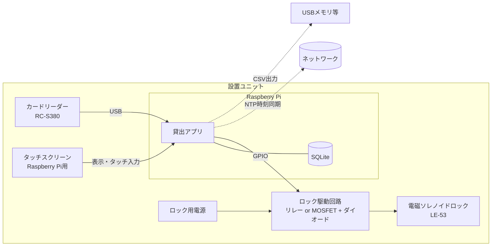
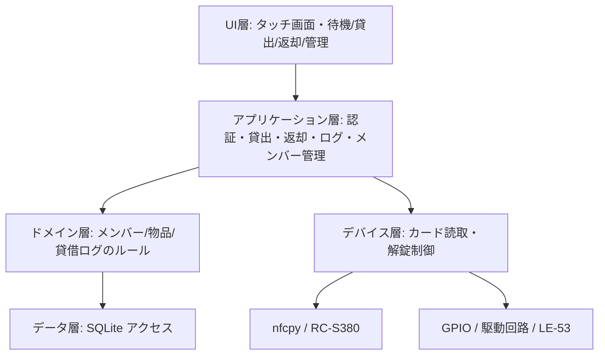
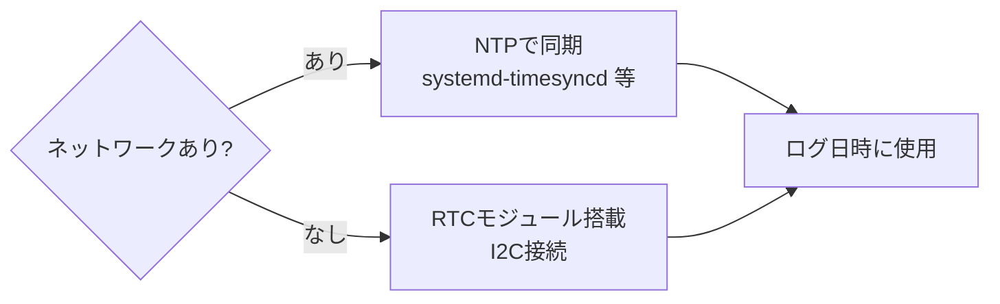

# システム設計書（基本設計）

| 項目 | 内容 |
|------|------|
| 文書種別 | システム設計書（基本設計） |
| バージョン | 1.0 |
| 作成日 | 2026-11-05 |

Raspberry Pi 1台にカードリーダー、タッチスクリーン、ロック駆動回路をつなぐスタンドアロン構成です。

---

## 1. システム構成図

| 構成要素 | 役割 | 要確認 |
|----------|------|--------|
| カードリーダー（RC-S380） | 社員証の IDm を読み取る | nfcpy で社員証が読めるか |
| タッチスクリーン | 操作画面の表示と入力 | 解像度に合わせた画面設計 |
| Raspberry Pi | アプリと DB を動かす | 機種、OS |
| ロック駆動回路 | GPIO の信号でロックに電流を流す | ロックの定格電圧・電流に合う部品選定 |
| 電磁ソレノイドロック（LE-53） | 保管庫を解錠する | 通電時解錠か、通電時施錠か |
| ロック用電源 | ロックを動かす電源 | Raspberry Pi と電源を分けるか |

詳細な配線・GPIO は [09_ハードウェア設計書](09_ハードウェア設計書.md) を参照。

## 2. アーキテクチャ方針

- **スタンドアロン：** Raspberry Pi 単体で貸出・返却が完結する（NFR-01）。ネットワークは NTP と任意同期にのみ使用。
- **単一プロセス・イベント駆動：** 待機画面を中心に、カードタッチと画面操作のイベントで状態遷移する。
- **関心の分離：** UI 層／業務ロジック層／デバイス層（カード・ロック）／データ層（SQLite）を分離し、デバイスはモック可能にする（テスト容易性・NFR）。

## 3. レイヤ構成（論理）

| 層 | 責務 | 主なモジュール（想定） |
|----|------|----------------------|
| UI 層 | 画面描画・タッチ入力・無操作タイムアウト | `ui/`（待機・貸出・返却・管理） |
| アプリケーション層 | ユースケースの手続き（UC1〜UC7） | `services/`（auth, loan, member, report） |
| ドメイン層 | 貸出中判定・返却予定算出・バリデーション | `domain/`（member, item, loan） |
| デバイス層 | カード読取・解錠通電の抽象化とモック | `devices/`（reader, lock） |
| データ層 | SQLite への CRUD、CSV 書き出し | `repository/`, `db.sqlite3` |

## 4. 主要コンポーネントと責務

| コンポーネント | 責務 | 対応要件 |
|----------------|------|----------|
| CardReader | IDm を読み取りイベントを発火 | FR-01 |
| AuthService | IDm → メンバー照合、ロール判定 | FR-01, FR-08 |
| LoanService | 貸出可否判定・貸出登録・返却登録 | FR-02, FR-03 |
| LockController | GPIO 制御で数秒解錠、確実に OFF 復帰 | FR-05, NFR-08 |
| MemberService | メンバー登録・無効化・削除 | FR-06 |
| ReportService | 期間指定 CSV 出力 | FR-07 |
| StatusView | 待機画面の状態・延滞表示 | FR-04, FR-09 |
| TimeSync | NTP/RTC による時刻整合 | NFR-03 |

## 5. 状態と画面の対応（概要）

| 物品状態 | 待機画面表示 | 可能な操作 |
|----------|-------------|-----------|
| 保管中 | 「貸出できます」 | 登録メンバーのタッチで貸出へ |
| 貸出中 | 「貸出中：氏名・返却予定」 | 本人タッチで返却へ／他者は状況確認のみ |
| 延滞 | 「延滞中」強調 | 本人タッチで返却へ |

状態遷移の詳細は [08_動的設計](08_動的設計.md)、画面は [07_画面設計書](07_画面設計書.md)。

## 6. 時刻同期方針（NFR-03）

Raspberry Pi は標準で時計用電池を持たないため、どちらの手段を採るかを設置環境（[10] Q8）に合わせて確定する。

## 7. 構成・運用パラメータ（設定で変更可能：NFR-13）

| パラメータ | 既定（暫定） | 説明 |
|------------|-------------|------|
| 解錠通電時間 | 数秒 | ソレノイド通電時間（FR-05, NFR-08） |
| 無操作タイムアウト | 数十秒 | 待機画面への自動復帰（NFR-06） |
| 貸出時間候補 | 15/30/60/120/240/480 分 | 貸出時間の選択肢（D4） |
| CSV 日時書式 | `YYYY/MM/DD hh:mm` | ログ出力書式（P5） |

## 8. 配備（デプロイ）

- 単一の Raspberry Pi に、OS 起動時に貸出アプリを自動起動（キオスク／フルスクリーン）。
- DB は SQLite 単一ファイル。定期バックアップ方針は運用で定める（ログ保管期間は [10] Q9）。
- CSV は外部メディア（USB）へ出力。

## 9. 想定リスクと対策

| リスク | 対策 |
|--------|------|
| RC-S380 で社員証が読めない（方式差） | 11/6 に実機確認（[10] Q10）。読めない場合リーダー見直し |
| LE-53 の極性（通電時解錠/施錠）の誤り | 定格・動作を仕様確認してから回路確定（[09]） |
| 停電時に鍵が取り出せない | 予備鍵運用（NFR-02, [10] Q7） |
| 時刻ずれでログが不正確 | NTP または RTC（NFR-03） |
