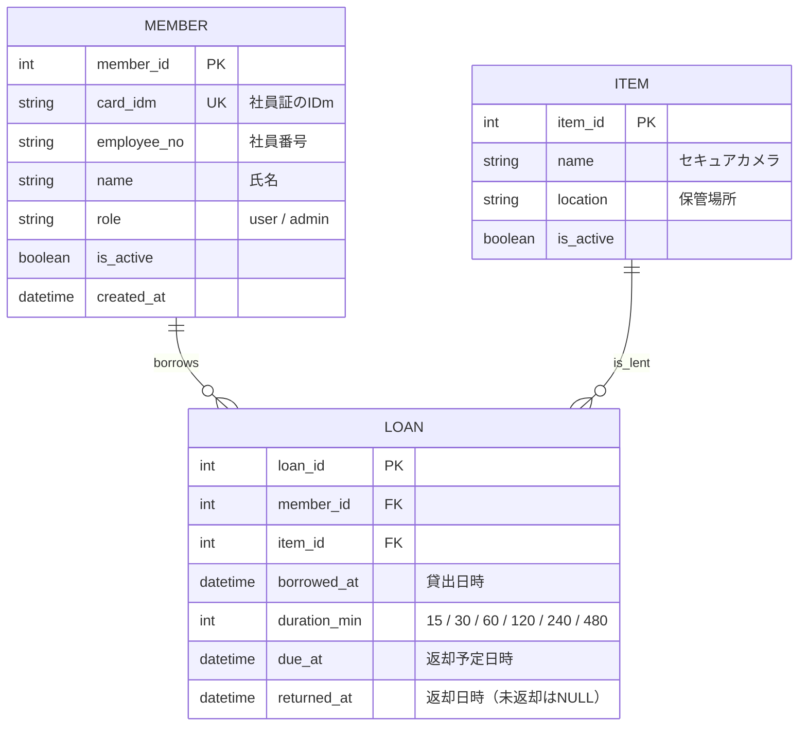

# データベース設計書

| 項目 | 内容 |
|------|------|
| 文書種別 | データベース設計書（論理・物理・CSV仕様） |
| バージョン | 1.0 |
| 作成日 | 2026-11-05 |
| DBMS | SQLite |

テーブルはメンバー・物品・貸借ログの3つで、貸借ログが帳票1行に当たります。

---

## 1. ER図



| テーブル | 役割 | 補足 |
|----------|------|------|
| MEMBER | 利用できる人の一覧 | `card_idm` を一意にして、未登録の社員証をはじく |
| ITEM | 貸出対象の物品 | 今はカメラ1件のみ。複数物品になっても構造は変えない（NFR-11） |
| LOAN | 貸借ログ | `returned_at` が NULL の行 = 貸出中。CSV 出力の元データ |

「貸出中か」は LOAN の `returned_at` が NULL の行の有無で判定するため、状態列を別に持たない。

## 2. テーブル定義（物理）

### 2.1 MEMBER（メンバー）

| 列名 | 型 | 制約 | 説明 |
|------|----|------|------|
| member_id | INTEGER | PK, AUTOINCREMENT | メンバー識別子 |
| card_idm | TEXT | UNIQUE, NOT NULL | 社員証の IDm（認証キー） |
| employee_no | TEXT | NOT NULL | 社員番号 |
| name | TEXT | NOT NULL | 氏名 |
| role | TEXT | NOT NULL, CHECK(role IN ('user','admin')) | ロール |
| is_active | INTEGER | NOT NULL, DEFAULT 1 | 有効フラグ（0/1） |
| created_at | TEXT | NOT NULL | 登録日時（ISO 8601） |

- インデックス：`card_idm`（UNIQUE）で高速照合。
- 無効化は物理削除ではなく `is_active = 0` を基本とする（過去ログとの整合維持）。

### 2.2 ITEM（物品）

| 列名 | 型 | 制約 | 説明 |
|------|----|------|------|
| item_id | INTEGER | PK, AUTOINCREMENT | 物品識別子 |
| name | TEXT | NOT NULL | 物品名（例：セキュアカメラ） |
| location | TEXT | | 保管場所 |
| is_active | INTEGER | NOT NULL, DEFAULT 1 | 有効フラグ |

- フェーズ1は1行のみ（セキュアカメラ）。複数物品対応（FR-11）でも構造を変えない。

### 2.3 LOAN（貸借ログ）

| 列名 | 型 | 制約 | 説明 |
|------|----|------|------|
| loan_id | INTEGER | PK, AUTOINCREMENT | 貸借ログ識別子 |
| member_id | INTEGER | NOT NULL, FK→MEMBER | 借りた人 |
| item_id | INTEGER | NOT NULL, FK→ITEM | 借りた物品 |
| borrowed_at | TEXT | NOT NULL | 貸出日時（ISO 8601） |
| duration_min | INTEGER | NOT NULL, CHECK(duration_min IN (15,30,60,120,240,480)) | 貸出時間（分） |
| due_at | TEXT | NOT NULL | 返却予定日時（= borrowed_at + duration_min） |
| returned_at | TEXT | NULL可 | 返却日時。NULL は貸出中 |

- インデックス：`(item_id, returned_at)` で「貸出中判定」を高速化。
- 追記主体で運用し、利用者操作での改変・削除は不可とする（NFR-04）。

## 3. 主な制約・ビジネスルール

| ルール | 実装方針 |
|--------|----------|
| 鍵は1本（同時貸出1件） | 貸出前に `item_id` の `returned_at IS NULL` 件数が 0 であることを確認 |
| 未登録は貸出不可 | 認証時に `card_idm` 一致かつ `is_active = 1` を必須 |
| 返却予定の算出 | `due_at = borrowed_at + duration_min 分` |
| 延滞判定 | `returned_at IS NULL` かつ `now > due_at` |

## 4. 代表的なクエリ（擬似 SQL）

```sql
-- 認証（IDm照合）
SELECT member_id, name, employee_no, role
FROM MEMBER WHERE card_idm = :idm AND is_active = 1;

-- 貸出中か（空き判定）
SELECT COUNT(*) FROM LOAN
WHERE item_id = :item_id AND returned_at IS NULL;

-- 本人の貸出中ログ（返却対象）
SELECT loan_id, borrowed_at, due_at FROM LOAN
WHERE item_id = :item_id AND member_id = :member_id AND returned_at IS NULL;

-- 貸出登録
INSERT INTO LOAN(member_id,item_id,borrowed_at,duration_min,due_at)
VALUES(:member_id,:item_id,:now,:dur,:due);

-- 返却登録
UPDATE LOAN SET returned_at = :now WHERE loan_id = :loan_id;

-- 延滞一覧
SELECT * FROM LOAN
WHERE returned_at IS NULL AND due_at < :now;
```

## 5. CSV 出力仕様（FR-07 / 帳票置き換え）

- 文字コード：UTF-8（BOM 要否は現場 Excel 運用に合わせ確定）
- 区切り：カンマ
- 日時書式：`YYYY/MM/DD hh:mm`（P5）
- 対象：指定期間に `borrowed_at` が含まれる LOAN
- 列は帳票と同項目にそろえる（最終項目は [10] Q1, Q2 の回答で確定）

### 暫定 CSV レイアウト

| 列 | 項目 | 元データ | 例 |
|----|------|----------|-----|
| 1 | 氏名 | MEMBER.name | 山田 太郎 |
| 2 | 社員番号 | MEMBER.employee_no | 100234 |
| 3 | 物品名 | ITEM.name | セキュアカメラ |
| 4 | 貸出日時 | LOAN.borrowed_at | 2026/11/07 09:30 |
| 5 | 貸出時間 | LOAN.duration_min | 60分 |
| 6 | 返却予定 | LOAN.due_at | 2026/11/07 10:30 |
| 7 | 返却日時 | LOAN.returned_at | 2026/11/07 10:12 |

> 氏名／社員番号のどちらを残すか・両方か（[10] Q1）、帳票と同形式が必須か（[10] Q2）の回答を受けて列を確定する。

## 6. DDL（暫定・SQLite）

```sql
CREATE TABLE MEMBER (
  member_id   INTEGER PRIMARY KEY AUTOINCREMENT,
  card_idm    TEXT NOT NULL UNIQUE,
  employee_no TEXT NOT NULL,
  name        TEXT NOT NULL,
  role        TEXT NOT NULL CHECK(role IN ('user','admin')),
  is_active   INTEGER NOT NULL DEFAULT 1,
  created_at  TEXT NOT NULL
);

CREATE TABLE ITEM (
  item_id   INTEGER PRIMARY KEY AUTOINCREMENT,
  name      TEXT NOT NULL,
  location  TEXT,
  is_active INTEGER NOT NULL DEFAULT 1
);

CREATE TABLE LOAN (
  loan_id      INTEGER PRIMARY KEY AUTOINCREMENT,
  member_id    INTEGER NOT NULL REFERENCES MEMBER(member_id),
  item_id      INTEGER NOT NULL REFERENCES ITEM(item_id),
  borrowed_at  TEXT NOT NULL,
  duration_min INTEGER NOT NULL CHECK(duration_min IN (15,30,60,120,240,480)),
  due_at       TEXT NOT NULL,
  returned_at  TEXT
);

CREATE INDEX idx_loan_active ON LOAN(item_id, returned_at);
```
