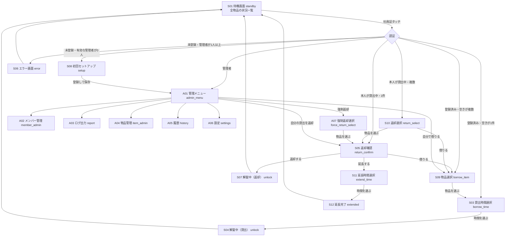

# 画面設計書

| 項目 | 内容 |
|------|------|
| 文書種別 | 画面設計書（画面一覧・遷移・画面ラフ） |
| バージョン | 1.2 |
| 作成日 | 2026-11-05（更新: 2026-11-20） |

> **更新メモ（2026-11-20）:** UI/UX 改善で画面を追加した。利用者向けに貸出延長（`extend_time`/`extended`）、
> 管理者向けに強制返却（`force_return_select`）・ログ閲覧（`history`）・設定（`settings`）。
> 待機画面に残り時間カウントダウン（「返却まで あと◯分」）、管理メニュー先頭にダッシュボード帯
> （貸出中/延滞/本日/今月・施錠状態・時刻同期）を追加。対応要件は FR-12・FR-16〜FR-20（[02]）。

利用者向けは11画面（うち初回限定1画面）、管理者向けは7画面です。待機画面から始まり、一定時間操作がなければ待機画面に戻ります（NFR-06）。画面IDは設計時の S/A 番号、実装の `screen` 値（`terminal.py`）を併記します。

---

## 1. 画面遷移図



## 2. 画面一覧

| ID | 画面（screen値） | 主な表示・操作 | 対応要件 |
|----|------|----------------|----------|
| S01 | 待機画面 `standby` | 「社員証をタッチしてください」、**全物品**の状況一覧（空き/貸出中/延滞、氏名・返却予定・**残り時間カウントダウン**） | FR-04, FR-09, FR-11 |
| S03 | 貸出時間選択 `borrow_time` | 15分/30分/1時間/2時間/4時間/8時間 の大きなボタン、キャンセル | FR-02 |
| S04 | 解錠中（貸出） `unlock` | 「鍵を取り出し、扉を閉めてください」、返却予定時刻 | FR-05 |
| S05 | 返却確認 `return_confirm` | 貸出日時、「返却する」「延長する」「借りる」「やめる」ボタン（強制返却時は返却/やめるのみ・利用者名を表示） | FR-03, FR-16, FR-17 |
| S06 | エラー `error` | 未登録・空き物品なしなどの理由 | FR-01 |
| S07 | 解錠中（返却） `unlock` | 「鍵を戻し、扉を閉めてください」 | FR-05 |
| S08 | 初回セットアップ `setup` | 有効な管理者が0人のときのみ出現。氏名・社員番号を入力し、タッチ済みのカードを管理者として登録 | FR-13 |
| S09 | 物品選択 `borrow_item` | 空いている物品が複数あるときのみ出現。物品名・保管場所から選ぶ | FR-02, FR-11 |
| S10 | 返却選択 `return_select` | 本人の未返却が複数あるときのみ出現。物品名・貸出日時・返却予定から選ぶ、「借りる」ボタンあり | FR-03, FR-11 |
| A01 | 管理メニュー `admin_menu` | **サマリ帯**（貸出中/延滞/本日/今月・施錠状態・時刻同期）、強制返却・メンバー管理・物品管理・履歴・ログ出力・設定・自分で借りる（＋自分の未返却があれば返却） | FR-08, FR-20 |
| A02 | メンバー管理 `member_admin` | 社員証タッチで登録、氏名・社員番号・ロールの入力、編集、ロール変更、カード再発行、無効化/再有効化 | FR-06, FR-14 |
| A03 | ログ出力 `report` | 期間を選んで CSV を書き出す | FR-07 |
| A04 | 物品管理 `item_admin` | 物品の追加、名称/保管場所の編集、有効化/無効化（貸出中・最後の有効物品は不可） | FR-15 |
| A05 | 履歴 `history` | 期間を指定して貸借ログを画面で閲覧（CSVと同項目・新しい順） | FR-12 |
| A06 | 設定 `settings` | 再起動不要で反映できる設定（解錠秒数・各タイムアウト・氏名表示・通知ON/OFF等）を編集して保存 | FR-19 |
| A07 | 強制返却選択 `force_return_select` | 貸出中（他人の分を含む）を一覧し、管理者が強制返却する物品を選ぶ→ S05 | FR-17 |
| S11 | 延長時間選択 `extend_time` | 返却確認から延長時間を選ぶ（貸出時間選択と同じ選択肢） | FR-16 |
| S12 | 延長完了 `extended` | 新しい返却予定を表示し、数秒後に待機へ戻る | FR-16 |

S08（setup）は有効な管理者が1人もいないときに未登録カードをタッチした場合だけ出現し、通常運用では発生しない。S09/S10 は対象が1件だけなら自動でスキップされ、タッチ回数は増えない。

## 3. 画面設計方針

- タッチスクリーンで指で押すため、**ボタンは大きく**、原則「**1画面1操作**」。
- 返却は「本人が貸出中ならタッチだけで返却確認へ進む」流れにし、ボタンを1つ減らす（対象が複数のときのみ選択画面を挟む）。
- どの画面も無操作が続けば待機画面（S01）へ自動復帰（NFR-06）。
- 状態・結果は短い日本語で明示（例「貸出できます」「貸出中」「延滞中」）。

## 3-1. デザイン方針（Material Design 3）

- UI は **Material Design 3（MD3）準拠のダークテーマ**を基本とし、CSS カスタムプロパティで MD3 カラートークン（`--md-sys-color-*` 相当）を定義する。ライトテーマへの切替が可能な構造にする。
- **完全オフライン**：CDN・外部フォントを使用しない（キオスク機にネット接続が無くても崩れない）。
- 画面タイトル表示・ブラウザタブは「**貸出管理システム**」（`index.html` の `<title>`）。
- 実装は `app/web/static/style.css`（MD3トークン定義） / `app/web/static/app.js`（画面ごとの描画関数）。
- デザインシステムの詳細（色役割・タイポ・部品・アンチパターン）は `docs/DESIGN.md` に定義。これは Google Stitch の taste-design 方法論を、安全第一のキオスク用途に合わせて調整（Creativity 4 / Variance 2 / Motion 3）して適用したもの。時刻・日付は等幅（tabular-nums）、入力はラベル上配置、全高は `100dvh`、絵文字・ネオングロー・純黒は不使用。

## 4. 画面ラフ（概念）

### S01 待機画面（保管中）
```
┌───────────────────────────────┐
│      セキュアカメラ 貸出        │
│                               │
│         ● 貸出できます          │
│                               │
│   社員証をタッチしてください     │
│        [ タッチ待ち ]           │
└───────────────────────────────┘
```

### S01 待機画面（貸出中／延滞）
```
┌───────────────────────────────┐
│      セキュアカメラ 貸出        │
│                               │
│   ▲ 貸出中（返却待ち）           │
│   利用者 : 山田 太郎            │
│   返却予定: 2026/11/07 10:30    │
│   ※延滞時はここを強調表示        │
│                               │
│   社員証をタッチしてください     │
└───────────────────────────────┘
```

### S01 待機画面（物品が複数：一覧表示）
```
┌───────────────────────────────┐
│        貸出管理システム          │
│                               │
│  ● カメラA        貸出できます   │
│  ▲ カメラB        貸出中・延滞   │
│       利用者: 鈴木 花子          │
│       返却予定: 2026/11/07 09:00 │
│  ● 三脚           貸出できます   │
│                               │
│   社員証をタッチしてください     │
└───────────────────────────────┘
```
物品が1件なら従来のシンプル表示、複数件ならこの一覧表示に出し分ける（`status_list()` の件数で判定）。

### S09 物品選択（borrow_item・空きが複数のときのみ）
```
┌───────────────────────────────┐
│       借りる物品を選んでください   │
│                               │
│  [ カメラA（保管庫A） ]          │
│  [ 三脚（保管庫B）   ]          │
│                               │
│              [ キャンセル ]      │
└───────────────────────────────┘
```

### S10 返却選択（return_select・未返却が複数のときのみ）
```
┌───────────────────────────────┐
│       返す物品を選んでください    │
│                               │
│  [ カメラA  貸出 09:30 / 予定10:30 ] │
│  [ 三脚    貸出 09:40 / 予定11:40 ] │
│                               │
│         [ 借りる ]  [ キャンセル ] │
└───────────────────────────────┘
```

### S03 貸出時間選択
```
┌───────────────────────────────┐
│       貸出時間を選んでください    │
│                               │
│  [ 15分 ]  [ 30分 ]  [ 1時間 ] │
│  [ 2時間]  [ 4時間 ] [ 8時間 ] │
│                               │
│              [ キャンセル ]      │
└───────────────────────────────┘
```

### S04 / S07 解錠中
```
┌───────────────────────────────┐
│          🔓 解錠しました         │
│                               │
│  S04: 鍵を取り出し、扉を閉めて   │
│       ください                 │
│  S07: 鍵を戻し、扉を閉めて       │
│       ください                 │
│                               │
│  （数秒後に待機画面へ戻ります）   │
└───────────────────────────────┘
```

### S05 返却確認
```
┌───────────────────────────────┐
│           返却しますか？         │
│                               │
│  物品名  : カメラA              │
│  貸出日時: 2026/11/07 09:30     │
│  返却予定: 2026/11/07 10:30     │
│                               │
│  [ 返却する ] [ 借りる ] [ やめる ] │
└───────────────────────────────┘
```
「借りる」は貸出導線（S09/S03）へ切り替えるボタン。return_select から来た場合も同様に表示する。

### S06 エラー
```
┌───────────────────────────────┐
│             ✕ エラー            │
│                               │
│  ・この社員証は登録されていません │
│   （または空いている物品がない） │
│                               │
│   数秒後に待機画面へ戻ります      │
└───────────────────────────────┘
```

### S08 初回セットアップ（setup・有効な管理者が0人のときのみ）
```
┌───────────────────────────────┐
│        初回セットアップ          │
│  このカードを管理者として登録します│
│                               │
│  氏名    : [            ]       │
│  社員番号: [            ]       │
│  [ 登録する ]                  │
└───────────────────────────────┘
```
有効な管理者が1人でもいれば、この画面は出現しない（未登録カードは通常のS06エラーになる）。

### A01 管理メニュー
```
┌───────────────────────────────┐
│           管理メニュー           │
│                               │
│   [ メンバー管理 ]              │
│   [ 物品管理 ]                 │
│   [ ログ出力 ]                 │
│   [ 自分で借りる ]              │
│   [ 自分の貸出を返却 ]（未返却がある場合のみ）│
│                               │
│              [ 戻る ]           │
└───────────────────────────────┘
```

### A02 メンバー管理
```
┌───────────────────────────────┐
│          メンバー管理            │
│  [ 社員証をタッチして登録 ]      │
│  氏名    : [            ]       │
│  社員番号: [            ]       │
│  ロール  : ( user / admin )     │
│  [ 保存 ]                      │
│  ── 登録済み ──                │
│  山田太郎  [編集][ロール変更]     │
│           [カード再発行][無効化]  │
│  鈴木花子  ...                  │
└───────────────────────────────┘
```
編集＝氏名・社員番号の更新。ロール変更＝user↔admin切替。カード再発行＝対象を選び、次のタッチのIDmへ付け替え（重複IDmはエラー）。最後の有効な管理者は無効化・降格・削除のボタン操作がすべて拒否される。

### A03 ログ出力
```
┌───────────────────────────────┐
│            ログ出力              │
│  期間: [ 2026/11/01 ]〜[ 11/30 ]│
│  出力先: USBメモリ               │
│                               │
│         [ CSVを書き出す ]        │
└───────────────────────────────┘
```

### A04 物品管理
```
┌───────────────────────────────┐
│            物品管理              │
│  物品名  : [            ]       │
│  保管場所: [            ]       │
│  [ 追加 ]                      │
│  ── 登録済み ──                │
│  カメラA（保管庫A）[編集][無効化] │
│  三脚   （保管庫B）[編集][無効化] │
└───────────────────────────────┘
```
貸出中の物品、および有効な物品が最後の1件になる無効化は拒否される。

## 5. 未確定点（画面に影響）

| 画面 | 未確定点 | 参照 |
|------|----------|------|
| S01 | 貸出中に氏名を表示してよいか | [10] Q4 |
| A03 | 帳票と同形式が必須か | [10] Q2 |
| S05 | 本人以外の返却を許すか | [10] Q6 |

> A02（メンバー登録を誰が行うか／管理画面が必要か、[10] Q3）は実装により解決済み：管理者がメンバー管理画面（A02）で行い、管理者が1人もいない初回だけは初回セットアップ（S08・FR-13）またはCLIで行う。
