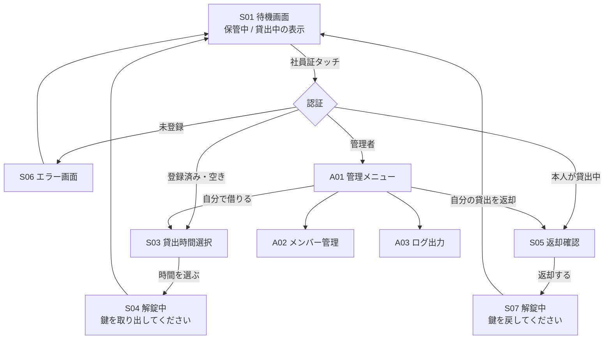

# 画面設計書

| 項目 | 内容 |
|------|------|
| 文書種別 | 画面設計書（画面一覧・遷移・画面ラフ） |
| バージョン | 1.0 |
| 作成日 | 2026-11-05 |

利用者向けは6画面、管理者向けは3画面です。待機画面から始まり、一定時間操作がなければ待機画面に戻ります（NFR-06）。

---

## 1. 画面遷移図



## 2. 画面一覧

| ID | 画面 | 主な表示・操作 | 対応要件 |
|----|------|----------------|----------|
| S01 | 待機画面 | 「社員証をタッチしてください」、物品の状態、貸出中なら氏名と返却予定 | FR-04, FR-09 |
| S03 | 貸出時間選択 | 15分/30分/1時間/2時間/4時間/8時間 の大きなボタン、キャンセル | FR-02 |
| S04 | 解錠中（貸出） | 「鍵を取り出し、扉を閉めてください」、返却予定時刻 | FR-05 |
| S05 | 返却確認 | 貸出日時、「返却する」ボタン | FR-03 |
| S06 | エラー | 未登録・他人が貸出中などの理由 | FR-01 |
| S07 | 解錠中（返却） | 「鍵を戻し、扉を閉めてください」 | FR-05 |
| A01 | 管理メニュー | メンバー管理、ログ出力、自分で借りる | FR-08 |
| A02 | メンバー管理 | 社員証タッチで登録、氏名・社員番号の入力、無効化 | FR-06 |
| A03 | ログ出力 | 期間を選んで CSV を書き出す | FR-07 |

## 3. 画面設計方針

- タッチスクリーンで指で押すため、**ボタンは大きく**、原則「**1画面1操作**」。
- 返却は「本人が貸出中ならタッチだけで返却確認へ進む」流れにし、ボタンを1つ減らす。
- どの画面も無操作が続けば待機画面（S01）へ自動復帰（NFR-06）。
- 状態・結果は短い日本語で明示（例「貸出できます」「貸出中」「延滞中」）。

## 4. 画面ラフ（概念）

### S01 待機画面（保管中）
```
┌───────────────────────────────┐
│      セキュアカメラ 貸出        │
│                               │
│         ● 貸出できます          │
│                               │
│   社員証をタッチしてください     │
│        [ タッチ待ち ]           │
└───────────────────────────────┘
```

### S01 待機画面（貸出中／延滞）
```
┌───────────────────────────────┐
│      セキュアカメラ 貸出        │
│                               │
│   ▲ 貸出中（返却待ち）           │
│   利用者 : 山田 太郎            │
│   返却予定: 2026/11/07 10:30    │
│   ※延滞時はここを強調表示        │
│                               │
│   社員証をタッチしてください     │
└───────────────────────────────┘
```

### S03 貸出時間選択
```
┌───────────────────────────────┐
│       貸出時間を選んでください    │
│                               │
│  [ 15分 ]  [ 30分 ]  [ 1時間 ] │
│  [ 2時間]  [ 4時間 ] [ 8時間 ] │
│                               │
│              [ キャンセル ]      │
└───────────────────────────────┘
```

### S04 / S07 解錠中
```
┌───────────────────────────────┐
│          🔓 解錠しました         │
│                               │
│  S04: 鍵を取り出し、扉を閉めて   │
│       ください                 │
│  S07: 鍵を戻し、扉を閉めて       │
│       ください                 │
│                               │
│  （数秒後に待機画面へ戻ります）   │
└───────────────────────────────┘
```

### S05 返却確認
```
┌───────────────────────────────┐
│           返却しますか？         │
│                               │
│  貸出日時: 2026/11/07 09:30     │
│  返却予定: 2026/11/07 10:30     │
│                               │
│   [ 返却する ]   [ やめる ]     │
└───────────────────────────────┘
```

### S06 エラー
```
┌───────────────────────────────┐
│             ✕ エラー            │
│                               │
│  ・この社員証は登録されていません │
│   （または貸出中のため不可）     │
│                               │
│   数秒後に待機画面へ戻ります      │
└───────────────────────────────┘
```

### A01 管理メニュー
```
┌───────────────────────────────┐
│           管理メニュー           │
│                               │
│   [ メンバー管理 ]              │
│   [ ログ出力 ]                 │
│   [ 自分で借りる ]              │
│                               │
│              [ 戻る ]           │
└───────────────────────────────┘
```

### A02 メンバー管理
```
┌───────────────────────────────┐
│          メンバー管理            │
│  [ 社員証をタッチして登録 ]      │
│  氏名    : [            ]       │
│  社員番号: [            ]       │
│  ロール  : ( user / admin )     │
│  [ 保存 ]                      │
│  ── 登録済み ──                │
│  山田太郎  [無効化] 鈴木花子 ... │
└───────────────────────────────┘
```

### A03 ログ出力
```
┌───────────────────────────────┐
│            ログ出力              │
│  期間: [ 2026/11/01 ]〜[ 11/30 ]│
│  出力先: USBメモリ               │
│                               │
│         [ CSVを書き出す ]        │
└───────────────────────────────┘
```

## 5. 未確定点（画面に影響）

| 画面 | 未確定点 | 参照 |
|------|----------|------|
| S01 | 貸出中に氏名を表示してよいか | [10] Q4 |
| A02 | メンバー登録を誰が行うか／管理画面が必要か | [10] Q3 |
| A03 | 帳票と同形式が必須か | [10] Q2 |
| S05 | 本人以外の返却を許すか | [10] Q6 |
