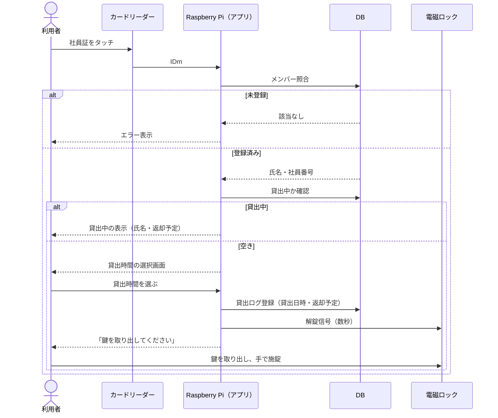
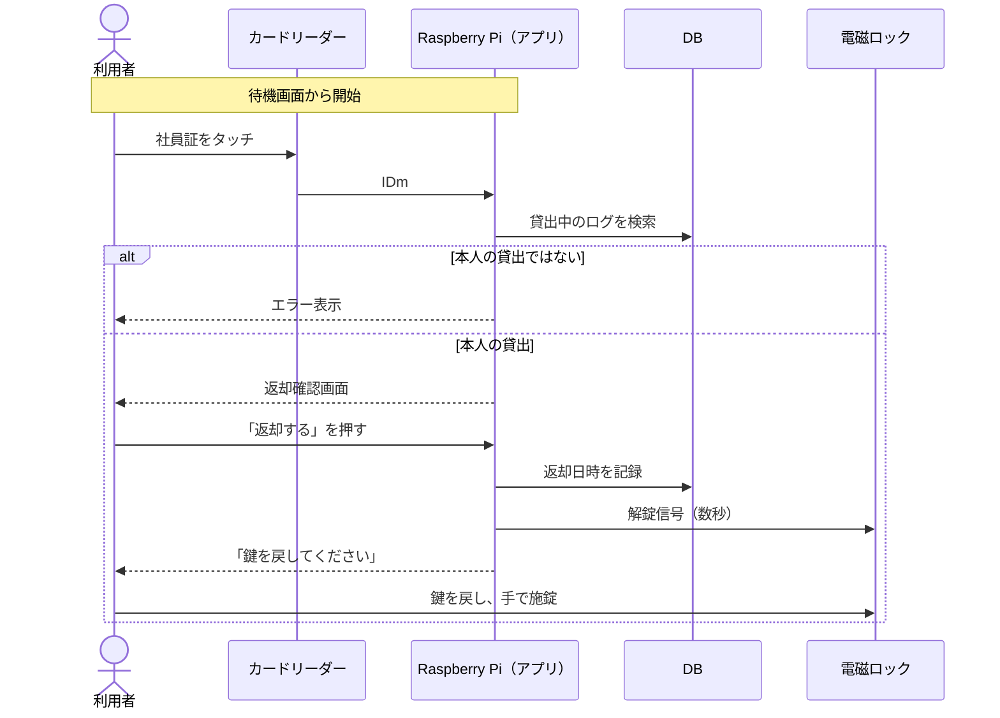
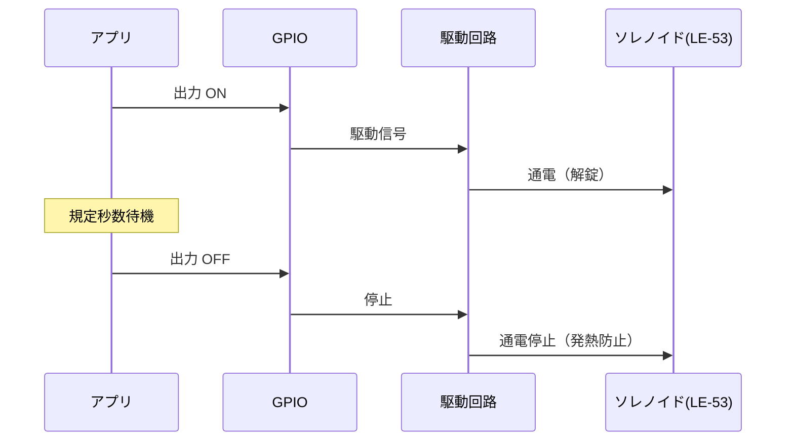
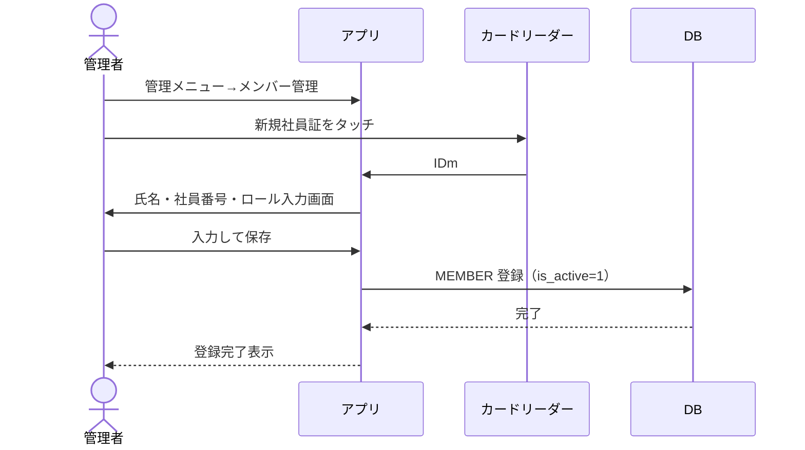
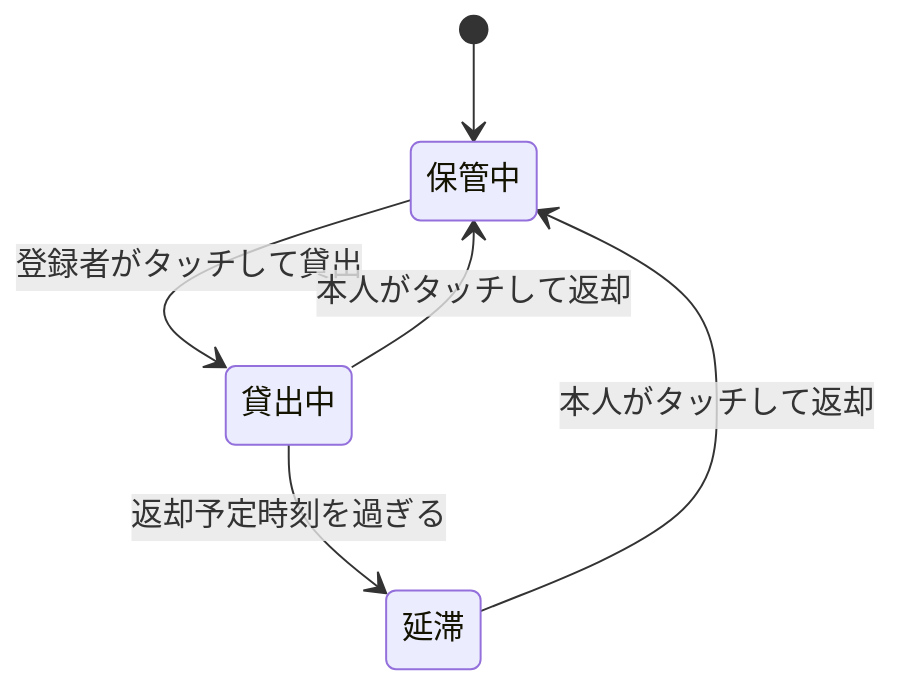
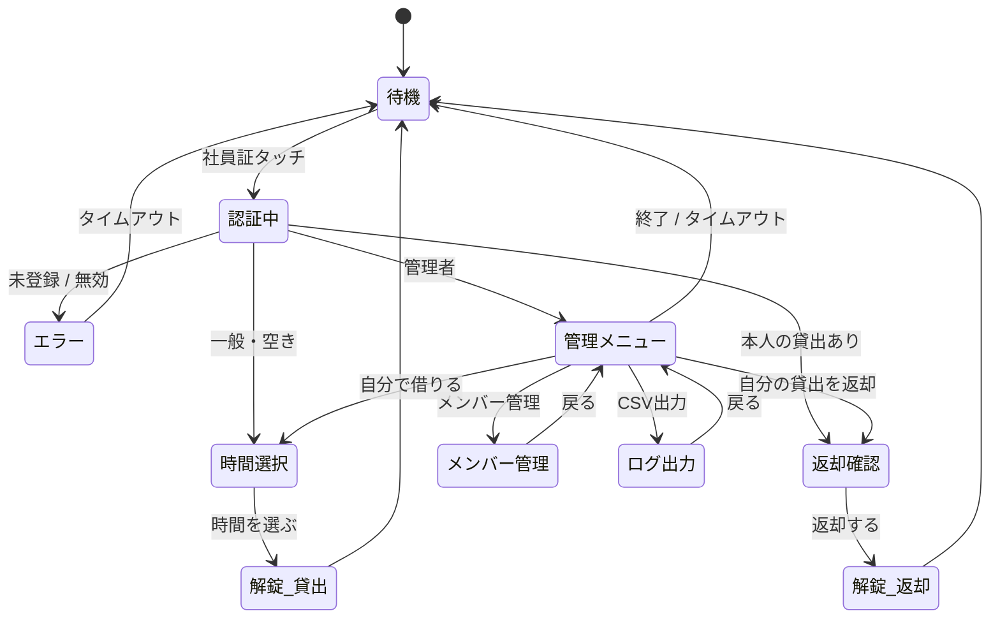

# 動的設計（シーケンス・状態遷移）

| 項目 | 内容 |
|------|------|
| 文書種別 | 動的設計（シーケンス図・状態遷移図） |
| バージョン | 1.0 |
| 作成日 | 2026-11-05 |

貸出と返却はどちらも「タッチ → 照合 → 解錠 → ログ記録」の同じ流れで、違いはログの書き込み先だけです。

---

## 1. シーケンス図

### 1-1. 貸出

### 1-2. 返却

本人以外による返却を認めるかは、管理者の運用に合わせて決める（[10] Q6）。

### 1-3. 解錠制御の内部（UC7 詳細）

### 1-4. メンバー登録（UC5）

## 2. 状態遷移図（物品）

物品の状態は「保管中」「貸出中」「延滞」の3つ。返却予定時刻を過ぎると延滞になります。

延滞時の通知を入れるかは確認事項（[10] Q5）。延滞も DB 上は貸出中（`returned_at IS NULL`）で、`now > due_at` により導出する。

## 3. 状態遷移表

| 現状態 | イベント | 条件 | 次状態 | 動作 |
|--------|----------|------|--------|------|
| 保管中 | 社員証タッチ | 登録メンバー・空き | 貸出中 | 貸出ログ登録・解錠 |
| 保管中 | 社員証タッチ | 未登録 | 保管中 | エラー表示 |
| 貸出中 | 社員証タッチ | 本人 | 保管中 | 返却日時記録・解錠 |
| 貸出中 | 社員証タッチ | 本人以外 | 貸出中 | 状況表示／エラー |
| 貸出中 | 時間経過 | `now > due_at` | 延滞 | 待機画面で強調 |
| 延滞 | 社員証タッチ | 本人 | 保管中 | 返却日時記録・解錠 |

## 4. アプリ画面状態（UI ステートマシン）

> `require_tap_to_start=true` のときは、待機の手前に「画面にタッチしてはじめる」待受（attract）を挟む。無操作が続くと各画面は待機（または attract）へ自動復帰する（NFR-06）。
