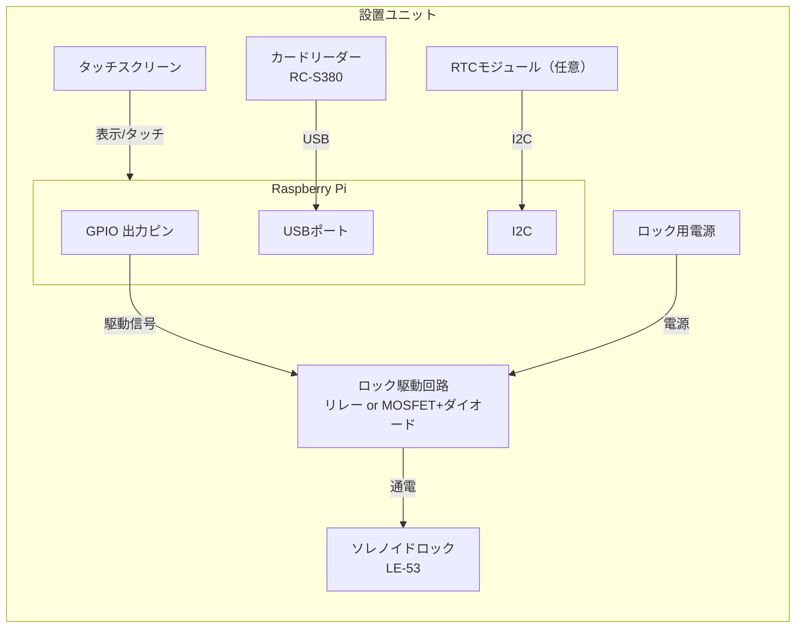
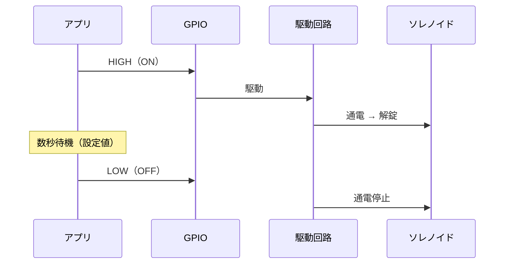
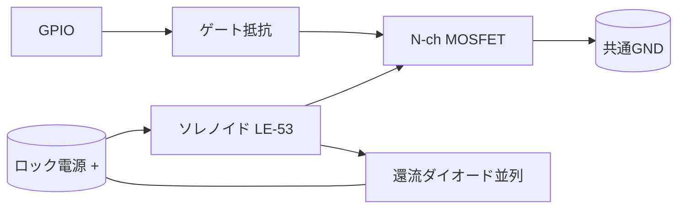

# ハードウェア設計書

| 項目 | 内容 |
|------|------|
| 文書種別 | ハードウェア設計書（機器構成・配線・解錠制御） |
| バージョン | 1.0 |
| 作成日 | 2026-11-05 |

Raspberry Pi 1台に、カードリーダー・タッチスクリーン・ロック駆動回路を接続するスタンドアロン構成です。施錠は人手、システムは解錠のみを担います（D8）。

---

## 1. 機器一覧（D10）

| 機器 | 型番／想定 | 接続 | 役割 |
|------|-----------|------|------|
| コントローラ | Raspberry Pi | — | アプリ・DB の実行 |
| タッチスクリーン | Raspberry Pi 用 | DSI / HDMI + USB タッチ | 操作画面・入力 |
| カードリーダー | Sony PaSoRi RC-S380 | USB | 社員証 IDm 読取 |
| ソレノイドロック | LE-53 | 駆動回路経由 | 保管庫の解錠 |
| ロック駆動回路 | リレー or MOSFET + 還流ダイオード | GPIO + ロック電源 | GPIO 信号で大電流を on/off |
| ロック用電源 | ソレノイド定格に合う DC 電源 | — | ソレノイド駆動 |
| RTC（任意） | I2C RTC モジュール | I2C | ネットワーク無時の時刻保持 |

## 2. 接続構成図

## 3. 解錠制御の設計（FR-05 / NFR-08）

- アプリは GPIO 出力を **数秒だけ ON** にして解錠し、その後 **必ず OFF** に戻す。
- 連続通電しない。コイルの発熱・焼損を避ける（P2）。施錠は人手のため通電維持は不要。

### タイミング・パラメータ

| 項目 | 値（暫定） | 備考 |
|------|-----------|------|
| 解錠通電時間 | 数秒 | 設定で変更可能（NFR-13） |
| 再解錠の最小間隔 | 任意 | 連打・連続通電の抑止 |

## 4. 駆動回路の設計方針

GPIO（3.3V / 小電流）ではソレノイドを直接駆動できないため、スイッチング素子を介する。

| 方式 | 構成 | 特徴 |
|------|------|------|
| リレー方式 | GPIO → トランジスタ → リレー → ソレノイド | 絶縁が容易・配線単純。機械音・応答やや遅 |
| MOSFET 方式 | GPIO → ゲート抵抗 → N-ch MOSFET → ソレノイド | 無音・高速。GND 共通に注意 |

共通の必須事項：

- **還流ダイオード（フライバックダイオード）** をソレノイドに並列に入れ、OFF 時の逆起電力からスイッチング素子を保護する。
- ロック用電源は **Raspberry Pi と分離**するか、十分な容量とノイズ対策を行う（[10] 要確認）。
- ソレノイドの GND と Pi の GND を共通にする（MOSFET 方式）。

## 5. 電気仕様の確認事項

LE-53 の仕様を取得してから部品定数と電源容量を確定する。

| 確認項目 | 理由 | 参照 |
|----------|------|------|
| 定格電圧・電流 | 電源容量・MOSFET/リレー選定に必要 | [10] 宿題 |
| 通電時の動作（解錠か施錠か） | ロジック（通電=解錠が前提）の確認 | [10] 宿題 |
| 突入電流 | 素子・電源のマージン | — |
| 連続使用時間の上限 | 数秒通電方針の妥当性 | NFR-08 |

> 本設計は「**通電時に解錠**」を前提にしている。LE-53 が「通電時に施錠（通常施錠は無通電）」型だった場合、解錠ロジックと安全側（停電時の挙動）を見直す。

## 6. カードリーダー（RC-S380）

- USB 接続、nfcpy で IDm を取得する想定。
- **要実機確認：** 社員証が FeliCa か、RC-S380 + nfcpy で IDm が読めるか（[10] Q10、宿題 11/6）。
- 読めない場合は、対応方式のリーダーへの変更を検討。

## 7. 時刻保持（NFR-03）

| 設置環境 | 手段 |
|----------|------|
| ネットワークあり | NTP 同期（systemd-timesyncd 等） |
| ネットワークなし | I2C RTC モジュールを追加 |

設置場所のネットワーク（[10] Q8）に応じて確定する。

## 8. 安全・運用上の留意

| 項目 | 内容 |
|------|------|
| 停電時 | 解錠不可。予備鍵で取り出せるようにする（NFR-02, [10] Q7） |
| 発熱 | 数秒通電・自動 OFF で抑制（NFR-08） |
| 逆起電力 | 還流ダイオード必須 |
| 電源分離 | ロックの突入電流で Pi が落ちないよう電源を分ける検討 |
