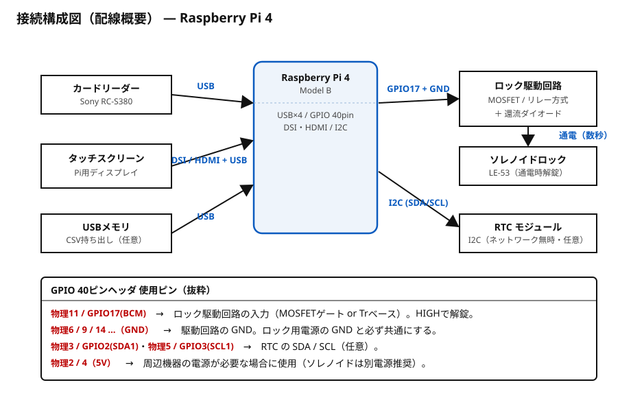
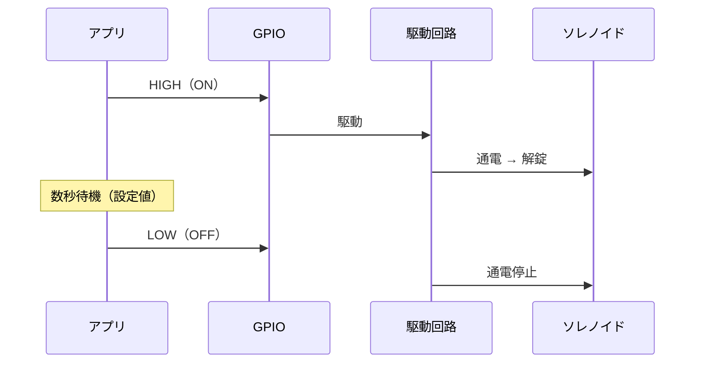
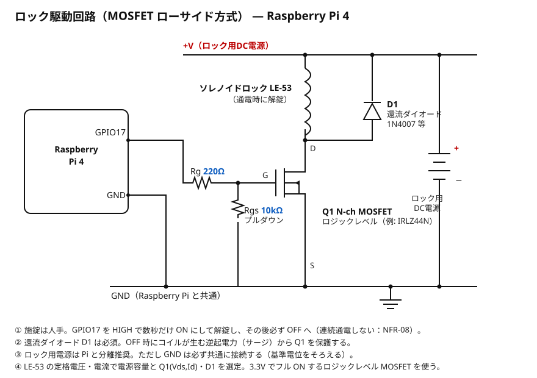
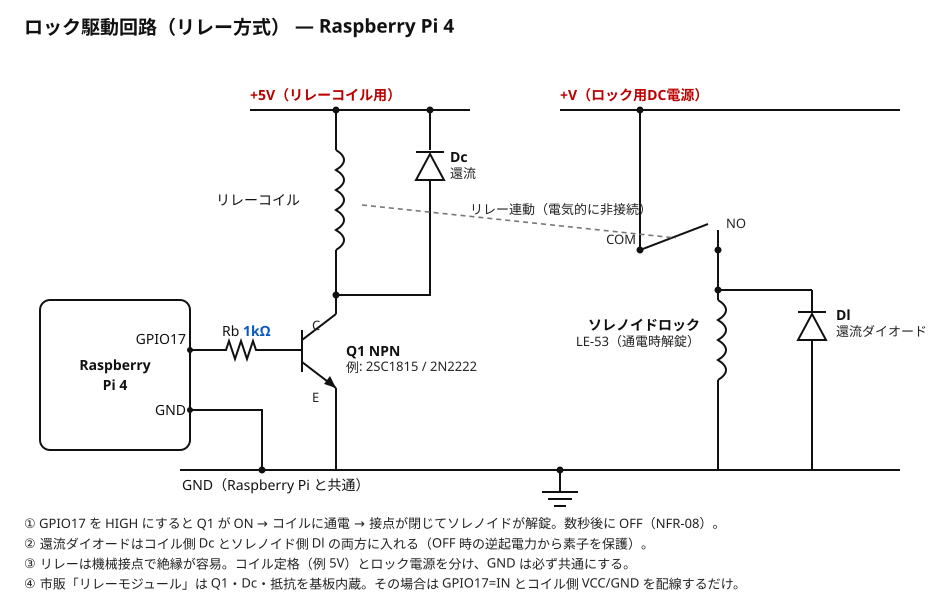

# ハードウェア設計書

| 項目 | 内容 |
|------|------|
| 文書種別 | ハードウェア設計書（機器構成・配線・解錠制御） |
| バージョン | 1.0 |
| 作成日 | 2026-11-05 |

Raspberry Pi 1台に、カードリーダー・タッチスクリーン・ロック駆動回路を接続するスタンドアロン構成です。施錠は人手、システムは解錠のみを担います（D8）。

---

## 1. 機器一覧（D10）

| 機器 | 型番／想定 | 接続 | 役割 |
|------|-----------|------|------|
| コントローラ | Raspberry Pi | — | アプリ・DB の実行 |
| タッチスクリーン | Raspberry Pi 用 | DSI / HDMI + USB タッチ | 操作画面・入力 |
| カードリーダー | Sony PaSoRi RC-S380 | USB | 社員証 IDm 読取 |
| ソレノイドロック | タキゲン LE-53（電磁スナッチロック, DC5V/2W, 通電時解錠・無通電で自動施錠, カムスイッチ付） | 駆動回路経由 | 保管庫の解錠 |
| ロック駆動回路 | リレー or MOSFET + 還流ダイオード | GPIO + ロック電源 | GPIO 信号で大電流を on/off |
| ロック用電源 | ソレノイド定格に合う DC 電源 | — | ソレノイド駆動 |
| RTC（任意） | I2C RTC モジュール | I2C | ネットワーク無時の時刻保持 |

## 2. 接続構成図

> 図版は [`diagrams/pi4_wiring.svg`](diagrams/pi4_wiring.svg)。GPIO17 を解錠出力に、I2C を RTC（任意）に割り当てる。

## 3. 解錠制御の設計（FR-05 / NFR-08）

- アプリは GPIO 出力を **数秒だけ ON** にして解錠し、その後 **必ず OFF** に戻す。
- 連続通電しない。コイルの発熱・焼損を避ける（P2）。施錠は人手のため通電維持は不要。

### タイミング・パラメータ

| 項目 | 値（暫定） | 備考 |
|------|-----------|------|
| 解錠通電時間 | 数秒 | 設定で変更可能（NFR-13） |
| 再解錠の最小間隔 | 任意 | 連打・連続通電の抑止 |

## 4. 駆動回路の設計方針

GPIO（3.3V / 小電流）ではソレノイドを直接駆動できないため、スイッチング素子を介する。

| 方式 | 構成 | 特徴 |
|------|------|------|
| リレー方式 | GPIO → トランジスタ → リレー → ソレノイド | 絶縁が容易・配線単純。機械音・応答やや遅 |
| MOSFET 方式 | GPIO → ゲート抵抗 → N-ch MOSFET → ソレノイド | 無音・高速。GND 共通に注意 |

共通の必須事項：

- **還流ダイオード（フライバックダイオード）** をソレノイドに並列に入れ、OFF 時の逆起電力からスイッチング素子を保護する。
- ロック用電源は **Raspberry Pi と分離**するか、十分な容量とノイズ対策を行う（[10] 要確認）。
- ソレノイドの GND と Pi の GND を共通にする（MOSFET 方式）。

### 4-1. MOSFET ローサイド方式（推奨）

GPIO17 → ゲート抵抗 Rg → N-ch MOSFET でローサイドスイッチ。ソレノイドに還流ダイオード D1 を並列に入れ、OFF 時の逆起電力から MOSFET を保護する。ゲートにはプルダウン Rgs を入れ、起動時の不定電位で誤解錠しないようにする。ロジックレベル MOSFET（3.3V でフル ON）を選ぶ。

### 4-2. リレー方式

GPIO17 → ベース抵抗 Rb → NPN トランジスタでリレーコイルを駆動し、接点でソレノイドを on/off する。コイル側 Dc・ソレノイド側 Dl の還流ダイオードを各々入れる。市販のリレーモジュールは Q1・Dc・抵抗を基板に内蔵しているため、GPIO17 を入力に、コイル用 VCC/GND を配線するだけで使える。

> 回路図ソース: [`diagrams/mosfet_driver.svg`](diagrams/mosfet_driver.svg) / [`diagrams/relay_driver.svg`](diagrams/relay_driver.svg)

## 5. 電気仕様（タキゲン LE-53 データシート）

| 項目 | 値 | 出所 |
|------|----|------|
| 製品 | 小型省電力電磁スナッチロック LE-53（タキゲン） | データシート |
| 定格電圧 | DC 5V | データシート |
| 消費電力 | 2W | データシート |
| 定格電流（算出） | 約 0.4A（= 2W ÷ 5V、コイル抵抗 ≈ 12.5Ω） | 算出 |
| 通電時の動作 | 解錠（無通電で自動施錠＝フェイルセキュア） | データシート |
| カムスイッチ | 付き（施錠時 ON）。接点容量は要カタログ確認 | データシート |
| 連続通電時の表面温度 | 約 70℃（やけど・放熱対策が必要） | データシート |
| 使用温度 / 湿度 | -5〜+40℃ / 85%RH 以下（結露なきこと） | データシート |
| 突入電流 / 保持力 / 外形・質量 | 未公表（詳細カタログ・メーカー問合せ） | — |

> 「**通電時に解錠**」であることをデータシートで確認（本設計の前提どおり）。無通電で施錠する**フェイルセキュア型**のため、**停電時は施錠のまま**になる。取り出し用の予備鍵を用意する（NFR-02, [10] Q7）。
> 電源は **DC5V・1A 以上**を目安（定常 0.4A ＋ 突入・余裕）。駆動素子は 0.4A 以上を流せるもの（MOSFET 方式はロジックレベル品、例 IRLZ44N）。

### 5-1. カムスイッチの活用（任意）

LE-53 はカムスイッチ（施錠時 ON）を内蔵する。これを GPIO 入力（プルアップ＋チャタリング対策）に取り込めば、「扉が実際に施錠されたか」をソフトで検知でき、施錠忘れ警告や返却確定の裏取りに使える。現状は人手施錠・DB の状態管理で足りるため未使用だが、拡張の余地として記録する。

> 出所: タキゲン 製品ページ（LE-53 小型省電力電磁スナッチロック）。定格電流・突入電流・外形等の未公表値は詳細カタログで確定する。

## 6. カードリーダー（RC-S380）

- USB 接続、nfcpy で IDm を取得する想定。
- **要実機確認：** 社員証が FeliCa か、RC-S380 + nfcpy で IDm が読めるか（[10] Q10、宿題 11/6）。
- 読めない場合は、対応方式のリーダーへの変更を検討。

## 7. 時刻保持（NFR-03）

| 設置環境 | 手段 |
|----------|------|
| ネットワークあり | NTP 同期（systemd-timesyncd 等） |
| ネットワークなし | I2C RTC モジュールを追加 |

設置場所のネットワーク（[10] Q8）に応じて確定する。

## 8. 安全・運用上の留意

| 項目 | 内容 |
|------|------|
| 停電時 | 解錠不可。予備鍵で取り出せるようにする（NFR-02, [10] Q7） |
| 発熱 | 数秒通電・自動 OFF で抑制（NFR-08） |
| 逆起電力 | 還流ダイオード必須 |
| 電源分離 | ロックの突入電流で Pi が落ちないよう電源を分ける検討 |
