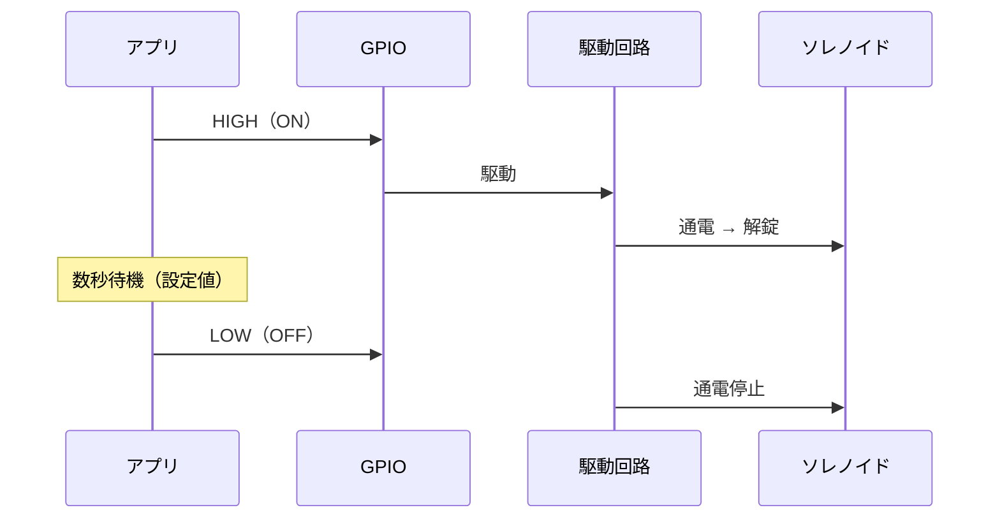
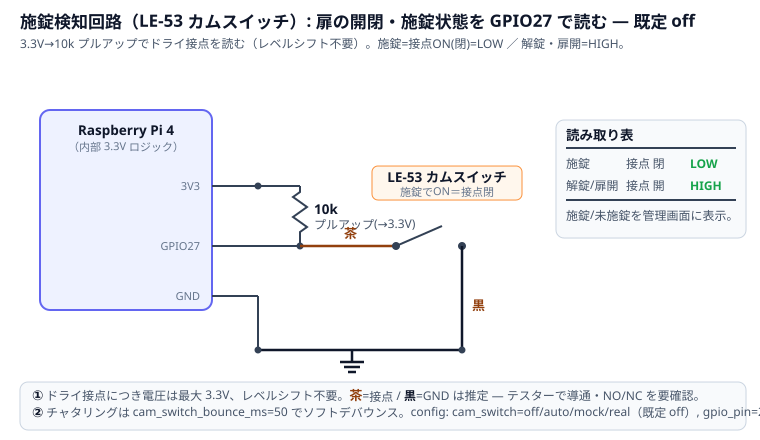

# ハードウェア設計書

| 項目 | 内容 |
|------|------|
| 文書種別 | ハードウェア設計書（機器構成・配線・解錠制御） |
| バージョン | 1.1 |
| 作成日 | 2026-11-05 |
| 更新日 | 2026-11-17（§5-1 カムスイッチ実装反映・電源保護(逆接/ヒューズ)追記） |

Raspberry Pi 1台に、カードリーダー・タッチスクリーン・ロック駆動回路を接続するスタンドアロン構成です。施錠は人手、システムは解錠のみを担います（D8）。

> **物理ロックは 1 系統（GPIO17 の 1 チャネル）です。** 物品マスタ（ITEM テーブル）は複数物品に対応しますが、解錠するキャビネットは 1 つを全物品で共有します（物品ごとの個別施錠はできません）。複数のキャビネットを個別に施解錠する要件が出た場合は、GPIO と駆動回路をチャネル数ぶん増設する設計変更が必要です。

---

## 1. 機器一覧（D10）

| 機器 | 型番／想定 | 接続 | 役割 |
|------|-----------|------|------|
| コントローラ | Raspberry Pi | — | アプリ・DB の実行 |
| タッチスクリーン | Raspberry Pi 用 | DSI / HDMI + USB タッチ | 操作画面・入力 |
| カードリーダー | Sony PaSoRi RC-S380 | USB | 社員証 IDm 読取 |
| ソレノイドロック | タキゲン LE-53（電磁スナッチロック, DC5V/2W, 通電時解錠・無通電で自動施錠, カムスイッチ付） | 駆動回路経由 | 保管庫の解錠 |
| ロック駆動回路 | LM393N ゲートドライバ + N-ch MOSFET **2SK4017** + 還流ダイオード（**MOSFET ローサイド方式を採用**） | GPIO + ロック電源 | GPIO 信号で大電流を on/off |
| ロック用電源 | ソレノイド定格に合う DC 電源 | — | ソレノイド駆動 |
| RTC（任意） | I2C RTC モジュール | I2C | ネットワーク無時の時刻保持 |

## 2. 接続構成図

> 図版は [`diagrams/pi4_wiring.svg`](diagrams/pi4_wiring.svg)。GPIO17 を解錠出力に、I2C を RTC（任意）に割り当てる。

## 3. 解錠制御の設計（FR-05 / NFR-08）

- アプリは GPIO 出力を **数秒だけ ON** にして解錠し、その後 **必ず OFF** に戻す。
- 連続通電しない。コイルの発熱・焼損を避ける（P2）。施錠は人手のため通電維持は不要。

### タイミング・パラメータ

| 項目 | 値（暫定） | 備考 |
|------|-----------|------|
| 解錠通電時間 | 数秒 | 設定で変更可能（NFR-13） |
| 再解錠の最小間隔 | 任意 | 連打・連続通電の抑止 |

## 4. 駆動回路の設計方針

GPIO（3.3V / 小電流）ではソレノイドを直接駆動できないため、スイッチング素子を介する。
**本設計は MOSFET ローサイド方式を採用する**（リレー方式は比較検討の結果、不採用）。

| 方式 | 構成 | 特徴 | 採否 |
|------|------|------|------|
| MOSFET 方式 | GPIO → LM393（レベルシフタ）→ ゲート抵抗 → N-ch MOSFET(2SK4017) → ソレノイド | 無音・高速。GND 共通に注意 | **採用** |
| リレー方式 | GPIO → トランジスタ → リレー → ソレノイド | 絶縁が容易・配線単純。機械音・応答やや遅 | 不採用（§4-2 は参考） |

共通の必須事項：

- **還流ダイオード（フライバックダイオード）** をソレノイドに並列に入れ、OFF 時の逆起電力からスイッチング素子を保護する。
- ロック用電源は **Raspberry Pi と分離**するか、十分な容量とノイズ対策を行う（[10] 要確認）。
- ソレノイドの GND と Pi の GND を共通にする（MOSFET 方式）。
- **ロック電源の保護（安全・必須級）**：DC5V ロック入力に **ヒューズ／ポリスイッチ**（定常 0.4A に対し 1A 前後、突入未公表のため現物で調整）と、**逆接保護**（直列ショットキー or 理想ダイオード P-FET）を入れる。還流ダイオード D1 は逆接時に順方向となり **電源直短絡**になるため、ヒューズと逆接保護がないと保護素子が存在しない。コネクタに極性誤接続の余地がある場合は必須。

### 4-1. MOSFET ローサイド方式（採用：LM393 ゲートドライバ + 2SK4017）

採用素子は **N-ch MOSFET 2SK4017（東芝, TO-220F）** と **コンパレータ LM393N**。

- **LM393 を非反転レベルシフタ（ゲートドライバ）として使う。** 非反転入力(IN+)には GPIO17（3.3V ロジック）を **入力分圧 Rin1/Rin2（10k/10k）で ≈1.65V に落として**与え、反転入力(IN−)には分圧 R1/R2 で作る基準電圧 ≈0.82V を与える。GPIO が HIGH（≈1.65V > 0.82V）のとき LM393 のオープンコレクタ出力が開放になり、プルアップ Rpu を介してゲートが約 5V まで引き上げられ 2SK4017 が ON（解錠）。GPIO が LOW のとき出力が Low に引き、ゲートは 0V で OFF。**極性は従来どおり HIGH=解錠**（`lock_active_high=true` は変更不要）。
- **2SK4017 はロジックレベル品ではない**（データシート: Vgs(th) 最大 2.5V、Rds(on)=0.07Ω の規定は Vgs=10V、Ciss≈730pF、Vdss60V/Id5A、パッケージ TO-220F）。GPIO の 3.3V 直駆動ではしきい値ぎりぎりで十分にオンしないため、LM393 で 5V ゲート駆動にして確実にオンさせる。LE-53 は ≈0.4A と軽負荷のため 5V 駆動でも Rds(on) による電圧降下は問題にならない。
- **入力コモンモードは入力分圧で解決済み。** LM393 の入力コモンモード範囲は電源 5V 時で約 0〜3.5V（Vcc−1.5V）。GPIO を 3.3V のまま直接入れると HIGH 側の余裕が約 0.2V しかなく、5V レールが 4.8V 以下に落ちると比較器出力が不定になり得た（旧設計の弱点）。本設計は **IN+=≈1.65V / IN−=≈0.82V** とも範囲の下半分に収めたので、5V が 4.0V 付近まで落ちても（Vcc−1.5=2.5V > 1.65V）コモンモードを割らない。**全段 5V 動作で 12V は不要**。さらに強い駆動が要る場合のみ +12V 別電源でゲートを上げる選択肢もある（§4-1 末尾の注記、ソレノイドは 5V のまま）。
- ソレノイドに還流ダイオード D1 を並列に入れ、OFF 時の逆起電力から 2SK4017 を保護する。ゲートに直列抵抗 Rg（保護）とプルダウン Rgs（起動時の不定電位で誤解錠しない）を入れる。LM393 はオープンコレクタ出力のため **プルアップ Rpu 必須**。未使用側コンパレータは入力を固定（例: +入力=GND / −入力=+5V）して発振を防ぎ、電源直近に 0.1µF のパスコンを置く。

| 部品 | 型番・値 | 役割 |
|------|----------|------|
| U1 | LM393N（コンパレータ, 1/2 回路使用） | 3.3V→5V 非反転レベルシフタ（ゲートドライバ） |
| Q1 | 2SK4017（N-ch MOSFET, TO-220F, G–D–S） | ローサイドスイッチ |
| Rin1 / Rin2 | 10kΩ / 10kΩ | GPIO17 入力分圧（IN+ を ≈1.65V に。コモンモード確保） |
| R1 / R2 | 22kΩ / 4.3kΩ | IN− の基準電圧 ≈0.82V を作る分圧 |
| Rpu | 1kΩ | LM393 オープンコレクタ出力のプルアップ（→+5V） |
| Rg | 100Ω | ゲート直列（保護・リンギング抑制） |
| Rgs | 10kΩ | ゲートプルダウン（確実オフ） |
| D1 | 1N4007 等 | 還流（フライバック）ダイオード |
| C1 | 0.1µF | LM393 電源パスコン |

#### 定数選定の根拠

数値は「2SK4017 / LM393N / LE-53 のデータシート値」＋「分圧・プルアップの単純な計算」から決めている。いずれも E24 系列の入手しやすい標準値。

| 値 | 根拠 |
|----|------|
| 入力分圧 **Rin1/Rin2=10k/10k**（IN+≈1.65V） | GPIO HIGH=3.3V を半分の **≈1.65V** に落とし、LM393 の入力コモンモード範囲（0〜Vcc−1.5V）の下半分へ収める。5V が 4.0V まで落ちても上限 2.5V を割らず、旧設計（3.3V 直入れ・余裕0.2V）の脆さを解消。GPIO 負荷は 3.3V/20k≈0.17mA と軽微。 |
| 基準電圧 **≈0.82V**（R1=22k / R2=4.3k） | 分圧後の HIGH≈1.65V と LOW=0V の **ほぼ中点**にしきい値を置き、双方へノイズマージンを確保する。計算: 5V × 4.3k/(22k+4.3k) = **0.817V**。標準値 22k/4.3k で狙える。分圧電流 ≈0.19mA は LM393 の入力バイアス電流（≈25nA）に対し十分大きく、基準が安定する。 |
| **Rpu = 1kΩ** | LM393 はオープンコレクタなので出力 HIGH はこの抵抗で作る。ゲート HIGH 電圧は Rpu と Rgs の分圧で決まり、**Vg(on) = 5V × Rgs/(Rpu+Rg+Rgs) = 5 × 10k/11.1k ≈ 4.5V**。確実にオンさせるには Rpu ≪ Rgs が必要で、1k を選択（10k だと ≈2.5V に落ちて不足）。出力 LOW 時のシンク電流 = 5V/1k = **5mA** で、LM393 の定格シンク（約16mA）内。 |
| **Rg = 100Ω** | ゲート直列。2SK4017 の入力容量（Ciss ≈730pF, データシート）とゲート配線のインダクタンスで生じるリンギングを制動する。本用途はほぼ DC スイッチングで高速性は不要なため、保護側に振って 100Ω。 |
| **Rgs = 10kΩ** | ゲートプルダウン。LM393 の出力が未確定になる電源投入直後でもゲートを 0V に保ち、**誤解錠を防ぐ**。Rpu（1k）より十分大きく取り、オン時のゲート電圧をほとんど下げない。オン時に流れる 0.45mA は無視できる。 |
| ゲート駆動 **≈5V** | 2SK4017 の Rds(on) 規定は Vgs=10V だが、負荷は LE-53 の **≈0.4A** と軽く、Vgs≈4.5V でも十分オン領域に入り電圧降下は問題にならない。ソレノイドが DC5V なので電源を共通化できる利点を優先。 |
| **D1 = 1N4007**（1A/1000V） | コイル電流 0.4A と OFF 時の逆起電力サージに対し余裕。安価で入手性が良い定番。 |
| **C1 = 0.1µF** | LM393 電源ピン直近の定番デカップリング（高周波ノイズ除去）。 |

> より強い駆動が必要なら、LM393 とゲートのプルアップを **+12V 別電源**にして Vgs を上げる（ソレノイドは 5V のまま、LM393 の入力コモンモード・絶対最大定格に注意）。この場合 Vg(on) ≈ 12 × Rgs/(Rpu+Rg+Rgs) となるため Rpu/Rgs の比はそのまま使える。

### 4-2. リレー方式（参考・不採用）

比較検討した代替案。**本設計では採用しない**（図面 [`diagrams/relay_driver.svg`](diagrams/relay_driver.svg) は参考として残す）。

GPIO17 → ベース抵抗 Rb → NPN トランジスタでリレーコイルを駆動し、接点でソレノイドを on/off する。コイル側 Dc・ソレノイド側 Dl の還流ダイオードを各々入れる。

> 回路図ソース: [`diagrams/mosfet_driver.svg`](diagrams/mosfet_driver.svg)（採用） / [`diagrams/relay_driver.svg`](diagrams/relay_driver.svg)（参考）

## 5. 電気仕様（タキゲン LE-53 データシート）

| 項目 | 値 | 出所 |
|------|----|------|
| 製品 | 小型省電力電磁スナッチロック LE-53（タキゲン） | データシート |
| 定格電圧 | DC 5V | データシート |
| 消費電力 | 2W | データシート |
| 定格電流（算出） | 約 0.4A（= 2W ÷ 5V、コイル抵抗 ≈ 12.5Ω） | 算出 |
| 通電時の動作 | 解錠（無通電で自動施錠＝フェイルセキュア） | データシート |
| カムスイッチ | 付き（施錠時 ON）。接点容量は要カタログ確認 | データシート |
| 連続通電時の表面温度 | 約 70℃（やけど・放熱対策が必要） | データシート |
| 使用温度 / 湿度 | -5〜+40℃ / 85%RH 以下（結露なきこと） | データシート |
| 突入電流 / 保持力 / 外形・質量 | 未公表（詳細カタログ・メーカー問合せ） | — |

> 「**通電時に解錠**」であることをデータシートで確認（本設計の前提どおり）。無通電で施錠する**フェイルセキュア型**のため、**停電時は施錠のまま**になる。取り出し用の予備鍵を用意する（NFR-02, [10] Q7）。
> 電源は **DC5V・2A 以上**を目安（定常 0.4A。スナッチロックは吸引初期の突入が定常の数倍になり得るが未公表のため、確定までは安全側をとる）。駆動段は **LM393N ゲートドライバ + N-ch MOSFET 2SK4017**（LM393 で 3.3V GPIO を 5V ゲート駆動にレベルシフト。2SK4017 は非ロジックレベルのため直駆動しない）。

### 5-1. カムスイッチの活用（施錠検知 I/O として利用）

LE-53 はカムスイッチ（施錠時 ON）を内蔵し、**駆動用（§4-1）とは別系統の 2 本（茶・黒）のケーブル**でスイッチ接点が引き出されている想定。これを GPIO 入力に取り込み、「扉が実際に施錠されたか／解錠・開のままか」をソフトで検知する。施錠忘れ警告や返却確定の裏取りに使える。**解錠は §4-1 の駆動回路、本節は施錠状態の“読み取り”で、回路としては独立**。

> 図版は [`diagrams/cam_switch_sense.svg`](diagrams/cam_switch_sense.svg)。ドライ接点を Pi 内部プルアップで読む（3.3V のみ・レベルシフト不要）。施錠=接点ON(閉)=LOW ／ 解錠・扉開=HIGH。

| 項目 | 内容 |
|------|------|
| 配線 | **茶 → GPIO 入力（例: GPIO27 / 物理13）**、**黒 → GND**。接点は GPIO27 と GND の間に入る。 |
| 入力設定 | Pi 内部 **プルアップ**を有効化（`gpiozero` の `Button(pull_up=True)` 等）。施錠でスイッチ ON（閉）→ 入力は **LOW**、解錠中は開 → プルアップで **HIGH**。 |
| チャタリング | ソフトでデバウンス（数十ms）。開閉の過渡でバタつくため。 |
| 用途 | 施錠確認（返却確定の裏取り）、施錠忘れ警告、カムスイッチと DB 状態の不一致検知。 |

> **ケーブル色（茶＝スイッチ／黒＝GND）は現物からの推定であり、必ずテスターとデータシートで導通・極性を確認してから接続すること。** タキゲン公式は「カムが施錠されている時、カムのスイッチは ON」と明記（＝施錠で接点閉）。スイッチ接点定格は DC30V/2A（抵抗負荷）・最小適用負荷 DC5V/100mA で、GPIO のドライ接点入力に十分（NO/NC の別は要現物確認）。
>
> **ソフト実装（既定 off）:** 施錠検知は `app/devices/cam_switch.py`（`GpioCamSwitch`, gpiozero `Button(pull_up=…)`）として実装済み。`config.json` の `cam_switch`（off/auto/mock/real）・`cam_switch_gpio_pin`（既定27）・`cam_switch_active_low`（既定true）・`cam_switch_bounce_ms`（既定50）で設定する。既定は **off**（＝状態不明を返す `NullLockSensor`）で既存動作に影響しない。有効時は管理メニューに現在の施錠状態（施錠/未施錠）を表示する。返却確定の裏取りや施錠忘れ警告への利用は、現物配線を確認してから段階的に広げる。

> 出所: タキゲン 製品ページ（LE-53 小型省電力電磁スナッチロック）。定格電流・突入電流・外形等の未公表値は詳細カタログで確定する。

## 6. カードリーダー（RC-S380）

- USB 接続、nfcpy で IDm を取得する想定。
- **要実機確認：** 社員証が FeliCa か、RC-S380 + nfcpy で IDm が読めるか（[10] Q10、宿題 11/6）。
- 読めない場合は、対応方式のリーダーへの変更を検討。

## 7. 時刻保持（NFR-03）

| 設置環境 | 手段 |
|----------|------|
| ネットワークあり | NTP 同期（systemd-timesyncd 等） |
| ネットワークなし | I2C RTC モジュールを追加 |

設置場所のネットワーク（[10] Q8）に応じて確定する。

## 8. 安全・運用上の留意

| 項目 | 内容 |
|------|------|
| 停電時 | 解錠不可。予備鍵で取り出せるようにする（NFR-02, [10] Q7） |
| 発熱 | 数秒通電・自動 OFF で抑制（NFR-08） |
| 逆起電力 | 還流ダイオード必須 |
| 過電流 | ロック電源にヒューズ／ポリスイッチ（1A 前後、突入は現物で確認） |
| 逆接保護 | 直列ショットキー／理想ダイオード。還流 D1 が逆接時に電源を短絡するため必須級 |
| 電源分離 | ロックの突入電流で Pi が落ちないよう電源を分ける検討 |
| 比較器マージン | 入力分圧 Rin1/Rin2 で IN+≈1.65V・IN−≈0.82V に下げ、5V 低下時もコモンモードを割らない（§4-1 で対策済み） |
