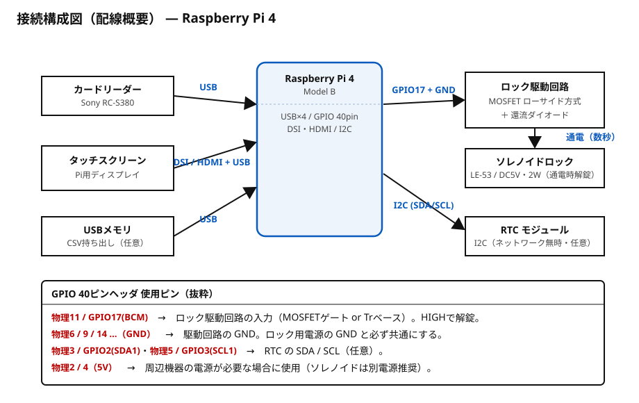
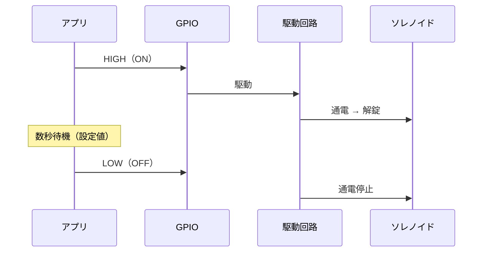
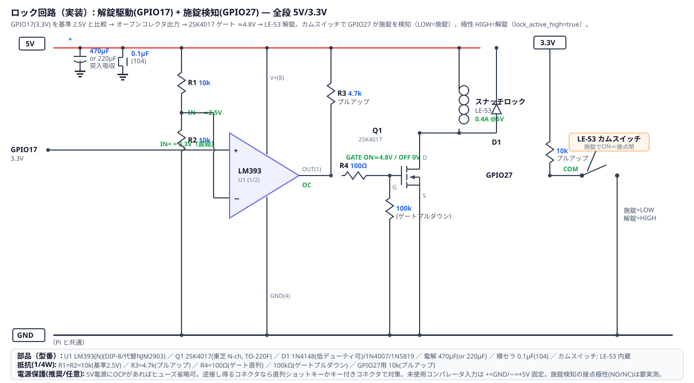

# ハードウェア設計書

| 項目 | 内容 |
|------|------|
| 文書種別 | ハードウェア設計書（機器構成・配線・解錠制御） |
| バージョン | 1.0 |
| 作成日 | 2026-11-05 |

Raspberry Pi 1台に、カードリーダー・タッチスクリーン・ロック駆動回路を接続するスタンドアロン構成です。施錠は人手、システムは解錠のみを担います（D8）。

---

## 1. 機器一覧（D10）

| 機器 | 型番／想定 | 接続 | 役割 |
|------|-----------|------|------|
| コントローラ | Raspberry Pi | — | アプリ・DB の実行 |
| タッチスクリーン | Raspberry Pi 用 | DSI / HDMI + USB タッチ | 操作画面・入力 |
| カードリーダー | Sony PaSoRi RC-S380 | USB | 社員証 IDm 読取 |
| ソレノイドロック | タキゲン LE-53（電磁スナッチロック, DC5V/2W, 通電時解錠・無通電で自動施錠, カムスイッチ付） | 駆動回路経由 | 保管庫の解錠 |
| ロック駆動回路 | LM393N ゲートドライバ + N-ch MOSFET **2SK4017** + 還流ダイオード（**MOSFET ローサイド方式を採用**） | GPIO + ロック電源 | GPIO 信号で大電流を on/off |
| ロック用電源 | ソレノイド定格に合う DC 電源 | — | ソレノイド駆動 |
| RTC（任意） | I2C RTC モジュール | I2C | ネットワーク無時の時刻保持 |

## 2. 接続構成図

> 図版は [`diagrams/pi4_wiring.svg`](diagrams/pi4_wiring.svg)。GPIO17 を解錠出力に、I2C を RTC（任意）に割り当てる。

## 3. 解錠制御の設計（FR-05 / NFR-08）

- アプリは GPIO 出力を **数秒だけ ON** にして解錠し、その後 **必ず OFF** に戻す。
- 連続通電しない。コイルの発熱・焼損を避ける（P2）。施錠は人手のため通電維持は不要。

### タイミング・パラメータ

| 項目 | 値（暫定） | 備考 |
|------|-----------|------|
| 解錠通電時間 | 数秒 | 設定で変更可能（NFR-13） |
| 再解錠の最小間隔 | 任意 | 連打・連続通電の抑止 |

## 4. 駆動回路の設計方針

GPIO（3.3V / 小電流）ではソレノイドを直接駆動できないため、スイッチング素子を介する。
**本設計は MOSFET ローサイド方式を採用する**（リレー方式は比較検討の結果、不採用）。

| 方式 | 構成 | 特徴 | 採否 |
|------|------|------|------|
| MOSFET 方式 | GPIO → LM393（レベルシフタ）→ ゲート抵抗 → N-ch MOSFET(2SK4017) → ソレノイド | 無音・高速。GND 共通に注意 | **採用** |
| リレー方式 | GPIO → トランジスタ → リレー → ソレノイド | 絶縁が容易・配線単純。機械音・応答やや遅 | 不採用（§4-2 は参考） |

共通の必須事項：

- **還流ダイオード（フライバックダイオード）** をソレノイドに並列に入れ、OFF 時の逆起電力からスイッチング素子を保護する。
- ロック用電源は **Raspberry Pi と分離**するか、十分な容量とノイズ対策を行う（[10] 要確認）。
- ソレノイドの GND と Pi の GND を共通にする（MOSFET 方式）。

### 4-1. MOSFET ローサイド方式（採用：LM393 ゲートドライバ + 2SK4017）

採用素子は **N-ch MOSFET 2SK4017（東芝, TO-220F）** と **コンパレータ LM393N**。

- **LM393 を非反転レベルシフタ（ゲートドライバ）として使う。** 非反転入力(IN+)に GPIO17（3.3V ロジック）、反転入力(IN−)に分圧 R1/R2 で作る基準電圧 ≈1.6V を与える。GPIO が HIGH（3.3V > 1.6V）のとき LM393 のオープンコレクタ出力が開放になり、プルアップ Rpu を介してゲートが約 5V まで引き上げられ 2SK4017 が ON（解錠）。GPIO が LOW のとき出力が Low に引き、ゲートは 0V で OFF。**極性は従来どおり HIGH=解錠**（`lock_active_high=true` は変更不要）。
- **2SK4017 はロジックレベル品ではない**（Vgs(th)=1.0〜2.5V、Rds(on) の規定は Vgs=10V）。GPIO の 3.3V 直駆動では十分にオンしないため、LM393 で 5V ゲート駆動にして確実にオンさせる。LE-53 は ≈0.4A と軽負荷のため 5V 駆動でも Rds(on) による電圧降下は問題にならない。
- ソレノイドに還流ダイオード D1 を並列に入れ、OFF 時の逆起電力から 2SK4017 を保護する。ゲートに直列抵抗 Rg（保護）とプルダウン Rgs（起動時の不定電位で誤解錠しない）を入れる。LM393 はオープンコレクタ出力のため **プルアップ Rpu 必須**。未使用側コンパレータは入力を固定（例: +入力=GND / −入力=+5V）して発振を防ぎ、電源直近に 0.1µF のパスコンを置く。

| 部品 | 型番・値 | 役割 |
|------|----------|------|
| U1 | LM393N（コンパレータ, 1/2 回路使用） | 3.3V→5V 非反転レベルシフタ（ゲートドライバ） |
| Q1 | 2SK4017（N-ch MOSFET, TO-220F, G–D–S） | ローサイドスイッチ |
| R1 / R2 | 10kΩ / 4.7kΩ | IN− の基準電圧 ≈1.6V を作る分圧 |
| Rpu | 1kΩ | LM393 オープンコレクタ出力のプルアップ（→+5V） |
| Rg | 100Ω | ゲート直列（保護・リンギング抑制） |
| Rgs | 10kΩ | ゲートプルダウン（確実オフ） |
| D1 | 1N4007 等 | 還流（フライバック）ダイオード |
| C1 | 0.1µF | LM393 電源パスコン |

> より強い駆動が必要なら、LM393 とゲートのプルアップを **+12V 別電源**にして Vgs を上げる（ソレノイドは 5V のまま、LM393 の入力コモンモード・絶対最大定格に注意）。

### 4-2. リレー方式（参考・不採用）

比較検討した代替案。**本設計では採用しない**（図面 [`diagrams/relay_driver.svg`](diagrams/relay_driver.svg) は参考として残す）。

GPIO17 → ベース抵抗 Rb → NPN トランジスタでリレーコイルを駆動し、接点でソレノイドを on/off する。コイル側 Dc・ソレノイド側 Dl の還流ダイオードを各々入れる。

> 回路図ソース: [`diagrams/mosfet_driver.svg`](diagrams/mosfet_driver.svg)（採用） / [`diagrams/relay_driver.svg`](diagrams/relay_driver.svg)（参考）

## 5. 電気仕様（タキゲン LE-53 データシート）

| 項目 | 値 | 出所 |
|------|----|------|
| 製品 | 小型省電力電磁スナッチロック LE-53（タキゲン） | データシート |
| 定格電圧 | DC 5V | データシート |
| 消費電力 | 2W | データシート |
| 定格電流（算出） | 約 0.4A（= 2W ÷ 5V、コイル抵抗 ≈ 12.5Ω） | 算出 |
| 通電時の動作 | 解錠（無通電で自動施錠＝フェイルセキュア） | データシート |
| カムスイッチ | 付き（施錠時 ON）。接点容量は要カタログ確認 | データシート |
| 連続通電時の表面温度 | 約 70℃（やけど・放熱対策が必要） | データシート |
| 使用温度 / 湿度 | -5〜+40℃ / 85%RH 以下（結露なきこと） | データシート |
| 突入電流 / 保持力 / 外形・質量 | 未公表（詳細カタログ・メーカー問合せ） | — |

> 「**通電時に解錠**」であることをデータシートで確認（本設計の前提どおり）。無通電で施錠する**フェイルセキュア型**のため、**停電時は施錠のまま**になる。取り出し用の予備鍵を用意する（NFR-02, [10] Q7）。
> 電源は **DC5V・2A 以上**を目安（定常 0.4A。スナッチロックは吸引初期の突入が定常の数倍になり得るが未公表のため、確定までは安全側をとる）。駆動段は **LM393N ゲートドライバ + N-ch MOSFET 2SK4017**（LM393 で 3.3V GPIO を 5V ゲート駆動にレベルシフト。2SK4017 は非ロジックレベルのため直駆動しない）。

### 5-1. カムスイッチの活用（任意）

LE-53 はカムスイッチ（施錠時 ON）を内蔵する。これを GPIO 入力（プルアップ＋チャタリング対策）に取り込めば、「扉が実際に施錠されたか」をソフトで検知でき、施錠忘れ警告や返却確定の裏取りに使える。現状は人手施錠・DB の状態管理で足りるため未使用だが、拡張の余地として記録する。

> 出所: タキゲン 製品ページ（LE-53 小型省電力電磁スナッチロック）。定格電流・突入電流・外形等の未公表値は詳細カタログで確定する。

## 6. カードリーダー（RC-S380）

- USB 接続、nfcpy で IDm を取得する想定。
- **要実機確認：** 社員証が FeliCa か、RC-S380 + nfcpy で IDm が読めるか（[10] Q10、宿題 11/6）。
- 読めない場合は、対応方式のリーダーへの変更を検討。

## 7. 時刻保持（NFR-03）

| 設置環境 | 手段 |
|----------|------|
| ネットワークあり | NTP 同期（systemd-timesyncd 等） |
| ネットワークなし | I2C RTC モジュールを追加 |

設置場所のネットワーク（[10] Q8）に応じて確定する。

## 8. 安全・運用上の留意

| 項目 | 内容 |
|------|------|
| 停電時 | 解錠不可。予備鍵で取り出せるようにする（NFR-02, [10] Q7） |
| 発熱 | 数秒通電・自動 OFF で抑制（NFR-08） |
| 逆起電力 | 還流ダイオード必須 |
| 電源分離 | ロックの突入電流で Pi が落ちないよう電源を分ける検討 |
