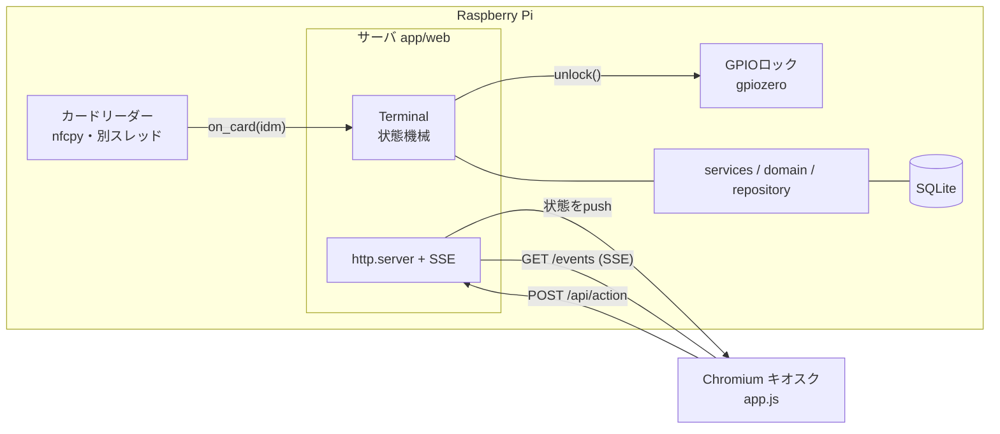
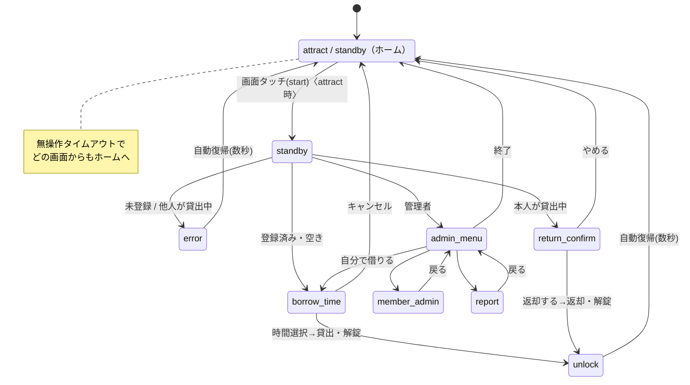
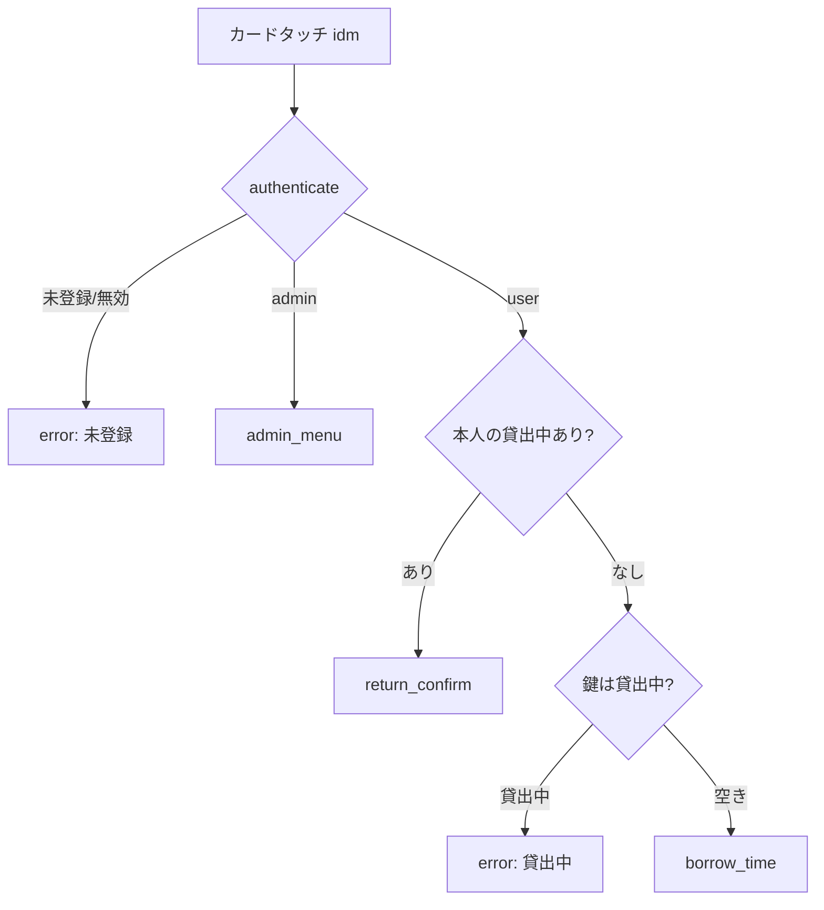

# ソフトウェア仕様書（実装版）

| 項目 | 内容 |
|------|------|
| 文書種別 | ソフトウェア仕様書（実装済みフェーズ1） |
| 対象 | セキュアカメラ貸出システム |
| バージョン | 1.0 |
| 作成日 | 2026-11-08 |

本書は **実装された動作** を仕様としてまとめたもの。設計意図は [`docs/`](../) の各設計書、
実行手順は [01_実装ガイド](01_実装ガイド.md)、テストは [02_テスト](02_テスト.md) を参照。

---

## 1. 概要・前提

- 社員証(IDm)のタッチで保管庫を解錠し、貸借ログを残す貸出システム（鍵1本・物品1件）。
- 対象機：Raspberry Pi 4 / Raspberry Pi OS Bookworm / Python 3.11。
- UI：ローカルWebアプリ（標準ライブラリ `http.server` + SSE、追加依存なし）。Pi 上では Chromium をキオスク表示。localhost 限定。
- 施錠は人手、システムは**解錠のみ**担当（CON-2）。
- 開発機（Windows 等）ではカード・ロックをモックして同一コードが動作。

## 2. アーキテクチャ

- **入力は2系統**：物理カード（リーダースレッド→`Terminal.on_card`）／画面操作（ブラウザ→`POST /api/action`）。
- **出力は1系統**：どちらの入力でも `Terminal` が状態を1つ進め、**SSEで現在状態をブラウザへpush**。
- 画面遷移の判断はすべてサーバ側 `Terminal`。ブラウザは「渡された状態を描画するだけ」。

### レイヤ（関心の分離）

| 層 | モジュール | 責務 |
|----|-----------|------|
| プレゼンテーション | `app/web/server.py`, `static/app.js` | HTTP/SSE、描画 |
| 画面制御 | `app/web/terminal.py` | 状態・遷移・タイマ |
| アプリケーション | `app/services/` | auth / loan / member / report / clock |
| ドメイン | `app/domain/models.py` | Member / Item / Loan と業務ルール |
| データ | `app/repository/`, `app/db.py` | SQLite アクセス |
| デバイス | `app/devices/` | カード読取・解錠（抽象＋mock/実機） |

## 3. 画面・状態

| 状態(screen) | 画面 | 主な表示 | 対応(07画面設計書) |
|--------------|------|----------|------|
| `attract` | 待受（要タッチ時のみ） | 「画面にタッチしてはじめる」＋空き状況 | （追加） |
| `standby` | 待機 | 「社員証をタッチしてください」＋保管中/貸出中(氏名・返却予定)/延滞 | S01 |
| `borrow_time` | 貸出時間選択 | 15/30分・1/2/4/8時間ボタン＋キャンセル | S03 |
| `unlock` | 解錠中 | 「鍵を取り出す/戻す」＋返却予定 | S04/S07 |
| `return_confirm` | 返却確認 | 貸出日時・返却予定＋「返却する」 | S05 |
| `error` | エラー | 理由（未登録・貸出中 等） | S06 |
| `admin_menu` | 管理メニュー | メンバー管理/ログ出力/自分で借りる | A01 |
| `member_admin` | メンバー管理 | IDm取込・氏名/社員番号/ロール登録・一覧(無効化/有効化) | A02 |
| `report` | ログ出力 | 期間指定・CSV書き出し | A03 |

ホーム（待受）画面は設定 `require_tap_to_start` により `attract`（true）または `standby`（false）。

### 状態遷移図

## 4. 操作（HTTP API 仕様）

| メソッド/パス | 用途 | 応答 |
|---------------|------|------|
| `GET /` | キオスク画面（index.html） | HTML |
| `GET /events` | SSE。接続直後に現在状態、以後は変化時にpush | `data: {screen, data}\n\n` |
| `GET /api/state` | 現在の画面状態（フォールバック） | `{screen, data}` |
| `GET /api/meta` | 物品名・モック判定・（モック時）疑似タッチ用メンバー | `{item_name, mock, dev_members?}` |
| `POST /api/action` | 操作 | `{ok, message?}` |

### `POST /api/action` の `type`

| type | パラメータ | 動作 | 前提状態 |
|------|-----------|------|----------|
| `start` | — | attract→standby | attract |
| `choose_duration` | `minutes` | 貸出確定・解錠 | borrow_time |
| `confirm_return` | — | 返却確定・解錠 | return_confirm |
| `cancel` | — | ホームへ | 任意 |
| `admin_menu` | — | 管理メニューへ戻る | admin系 |
| `open_member_admin` | — | メンバー管理へ | admin |
| `open_report` | — | ログ出力へ | admin |
| `admin_self_borrow` | — | 管理者が貸出時間選択へ | admin |
| `register_member` | `name,employee_no,role` | メンバー登録（結果返却） | member_admin |
| `set_member_active` | `member_id,active` | 有効化/無効化 | member_admin |
| `export_report` | `start,end,path` | CSV書き出し（結果返却） | report |
| `dev_card` | `idm` | 疑似カードタッチ（モック時のみ） | — |

- `register_member` / `export_report` は `{ok, message}` を返し、画面にトースト表示。他は状態をSSEで反映。
- ボディは UTF-8 JSON（ブラウザの `fetch`/`JSON.stringify` 準拠）。

## 5. 認証と分岐ルール（待機画面でのカードタッチ）

- 認証キーは **IDm のみ**（カード内部データは読まない：CON-4）、かつ `is_active=1`。
- 待機画面(`standby`)以外のカードタッチは無視。例外：`member_admin` では登録用に IDm を取り込む。
- `attract` 画面ではカードを無視（画面タッチが先）。

## 6. 業務ルール

| ルール | 実装 |
|--------|------|
| 鍵は1本・同時貸出1件（CON-3） | 貸出前に `LOAN.returned_at IS NULL` 件数=0 を確認。埋まっていれば拒否 |
| 返却予定の算出 | `due_at = borrowed_at + duration_min 分` |
| 貸出時間 | 15/30/60/120/240/480 分のみ（それ以外は拒否） |
| 返却対象 | 既定は本人の貸出中ログのみ。`allow_return_by_others=true` で他人も可 |
| 延滞判定（FR-09） | `returned_at IS NULL` かつ `now > due_at`。待受で赤強調 |
| 氏名表示（Q4） | `show_borrower_name` で待受の利用者名表示を切替 |

## 7. データモデル

[06 データベース設計書](../06_データベース設計書.md) の DDL をそのまま実装（`schema.sql`）。

- `MEMBER(member_id, card_idm UNIQUE, employee_no, name, role, is_active, created_at)`
- `ITEM(item_id, name, location, is_active)` … フェーズ1は1件（起動時に自動投入）
- `LOAN(loan_id, member_id, item_id, borrowed_at, duration_min, due_at, returned_at)`

- 「貸出中」= `LOAN.returned_at IS NULL` の有無で判定（状態列は持たない）。
- ログは追記主体、利用者操作で改変・削除しない（NFR-04）。無効化は `is_active=0`（物理削除は管理機能のみ）。
- 日時は ISO 8601（秒精度）で保存し、表示・CSV で書式変換。

## 8. 解錠制御仕様（FR-05 / NFR-08）

- 貸出確定・返却確定の時に `LockController.unlock()` を呼ぶ。
- **通電時解錠（LE-53）**：GPIO を `unlock_seconds` 秒だけ ON にして解錠し、その後 **必ず OFF**。
- 連続通電しない（発熱・焼損防止）。`min_reunlock_seconds` 未満の連続要求・解錠中の再入は抑止。
- 実機は `gpiozero.DigitalOutputDevice`（`lock_gpio_pin` / `lock_active_high`）、開発機はモック（コンソール出力）。

## 9. デバイス抽象と自動選択

- インタフェース `CardReader` / `LockController`（`app/devices/base.py`）。
- `factory.py` が `/proc/device-tree/model` で Raspberry Pi を判定：
  - Pi かつ対応ライブラリ有り → 実機（nfcpy / gpiozero）
  - それ以外 → モック
- 設定 `card_reader` / `lock` に `"mock"` / `"real"` を指定すれば明示選択も可（既定 `"auto"`）。

## 10. 設定項目（`config.json` / NFR-13）

| キー | 既定 | 意味 |
|------|------|------|
| `db_path` | lending.sqlite3 | SQLite ファイル |
| `item_name` / `item_location` | セキュアカメラ / 保管庫A | 物品 |
| `unlock_seconds` | 5 | 解錠通電時間 |
| `min_reunlock_seconds` | 3 | 再解錠の最小間隔 |
| `idle_timeout_seconds` | 30 | 無操作で待受へ復帰 |
| `result_screen_seconds` | 6 | 解錠中/エラー画面の自動復帰まで |
| `duration_choices_min` | [15,30,60,120,240,480] | 貸出時間候補 |
| `csv_datetime_format` | `%Y/%m/%d %H:%M` | 日時書式 |
| `csv_encoding` | utf-8-sig | CSV文字コード（Excel対応） |
| `show_borrower_name` | true | 待受で氏名表示（Q4） |
| `allow_return_by_others` | false | 本人以外の返却可否（Q6） |
| `require_tap_to_start` | false | 最初に画面タッチ待受(attract)を挟むか |
| `lock_gpio_pin` | 17 | 解錠GPIO（BCM） |
| `lock_active_high` | true | 駆動回路の論理 |
| `card_reader` / `lock` | auto | デバイス選択 |

## 11. タイマ（サーバ側）

- **無操作タイムアウト（NFR-06）**：`idle_timeout_seconds`。ホーム以外の画面で無操作が続くとホームへ。カード/操作でリセット。
- **結果画面の自動復帰**：`unlock` / `error` は `result_screen_seconds` 後にホームへ。
- いずれも `threading.Timer`。発火でホーム状態をSSE push。

## 12. CSV出力仕様（FR-07 / NFR-12）

- 対象：指定期間に `borrowed_at` が含まれる LOAN。
- 列：`氏名, 社員番号, 物品名, 貸出日時, 貸出時間, 返却予定, 返却日時`（帳票同項目）。
- 日時書式 `YYYY/MM/DD hh:mm`、貸出時間は「60分」等、文字コードは `csv_encoding`。

## 13. スレッド・排他

- サーバはリクエストごとに別スレッド（`ThreadingHTTPServer`）＋リーダースレッド＋タイマースレッドが並行。
- SQLite は `check_same_thread=False` で共有し、**全DBアクセスを `AppContext.db_lock`（RLock）で直列化**。`Terminal` の状態遷移も同ロックで保護。
- SSE はクライアントごとのキューにブロードキャスト。クライアント切断時の例外は正常系として黙殺。

## 14. 要件トレース（フェーズ1）

| 要件 | 実装 |
|------|------|
| FR-01 認証 | `services/auth.py`・IDm照合 |
| FR-02 貸出 | `services/loan.py` borrow（空き判定・due算出・解錠） |
| FR-03 返却 | `loan.py` return_loan（本人判定・設定切替） |
| FR-04/09 状況・延滞 | `loan.py` status / `Loan.is_overdue` |
| FR-05 解錠制御 | `devices/gpio_lock.py` |
| FR-06 メンバー管理 | `services/member.py` + member_admin |
| FR-07 CSV出力 | `services/report.py` |
| FR-08 管理者認証 | role=admin で admin_menu |
| NFR-06 無操作復帰 | `terminal.py` アイドルタイマ |
| NFR-07 2秒以内 | SSE push（ポーリングなし） |
| NFR-13 設定変更 | `config.json` |

## 15. 対象外（フェーズ2／本実装の範囲外）

- FR-10 延滞通知、FR-11 複数物品対応、FR-12 Webログ閲覧（別端末からの閲覧）。
- 実機デバイスの結合確認（RC-S380実読取・GPIO実通電・NTP/RTC）は実機作業（[10 課題・確認事項管理表](../10_課題・確認事項管理表.md)）。
