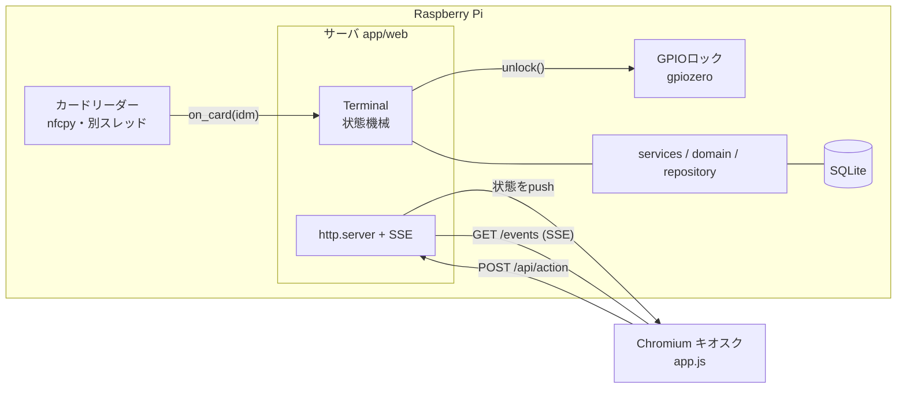
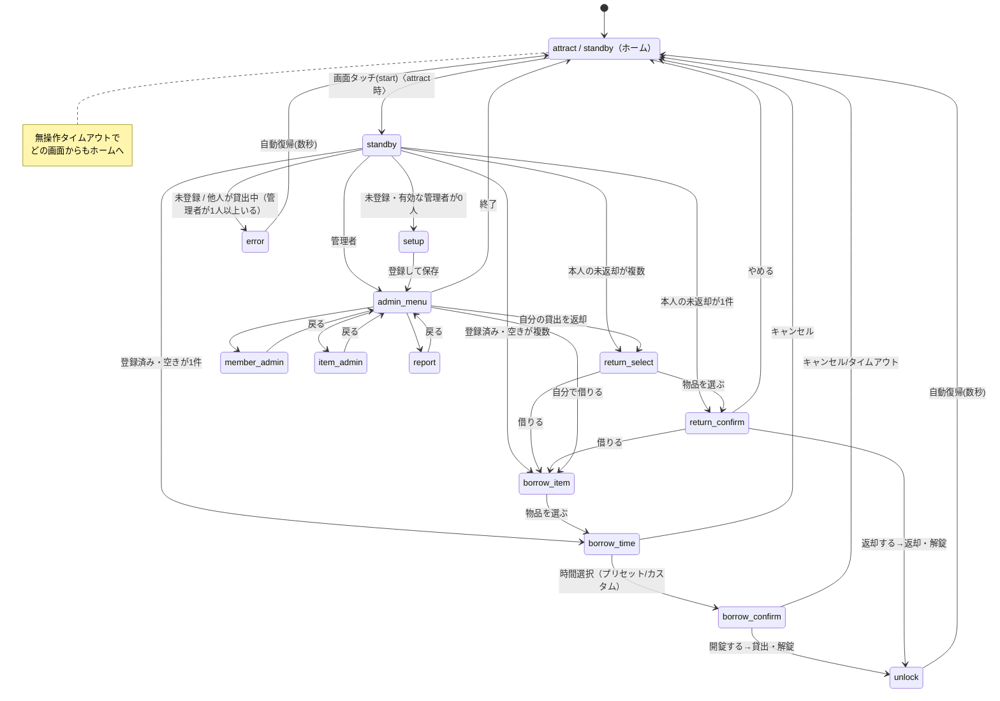
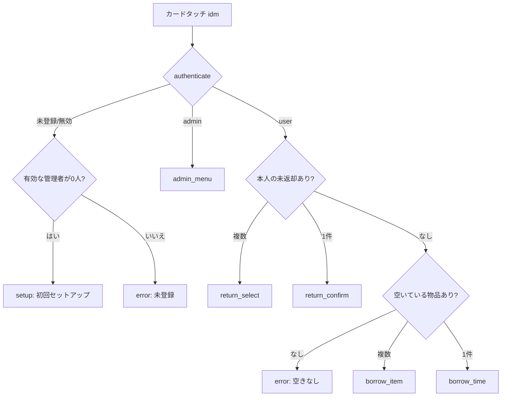

# ソフトウェア仕様書（実装版）

| 項目 | 内容 |
|------|------|
| 文書種別 | ソフトウェア仕様書（実装済みフェーズ1） |
| 対象 | 貸出管理システム（旧称: セキュアカメラ貸出システム） |
| バージョン | 1.2 |
| 作成日 | 2026-11-08（更新: 2026-11-20） |

本書は **実装された動作** を仕様としてまとめたもの。設計意図は [`docs/`](../) の各設計書、
実行手順は [01_実装ガイド](01_実装ガイド.md)、テストは [02_テスト](02_テスト.md) を参照。

---

## 1. 概要・前提

- 社員証(IDm)のタッチで保管庫を解錠し、貸借ログを残す貸出システム。錠（GPIO）は1本だが、物品（ITEM）は複数行対応し、1人が複数物品を同時に借りられる。
- 対象機：Raspberry Pi 4 / Raspberry Pi OS Bookworm / Python 3.11。
- UI：ローカルWebアプリ（標準ライブラリ `http.server` + SSE、追加依存なし）。Pi 上では Chromium をキオスク表示。localhost 限定。Material Design 3 準拠のダークテーマ、完全オフライン（CDN・外部フォント不使用）。
- 施錠は人手、システムは**解錠のみ**担当（CON-2）。
- 開発機（Windows 等）ではカード・ロックをモックして同一コードが動作。
- 有効な管理者（`role='admin'` かつ `is_active=1`）が0人のときは、未登録カードのタッチで初期管理者登録画面（setup）に誘導する（鶏卵問題の解消。FR-13）。

## 2. アーキテクチャ

- **入力は2系統**：物理カード（リーダースレッド→`Terminal.on_card`）／画面操作（ブラウザ→`POST /api/action`）。
- **出力は1系統**：どちらの入力でも `Terminal` が状態を1つ進め、**SSEで現在状態をブラウザへpush**。
- 画面遷移の判断はすべてサーバ側 `Terminal`。ブラウザは「渡された状態を描画するだけ」。

### レイヤ（関心の分離）

| 層 | モジュール | 責務 |
|----|-----------|------|
| プレゼンテーション | `app/web/server.py`, `static/app.js` | HTTP/SSE、描画 |
| 画面制御 | `app/web/terminal.py` | 状態・遷移・タイマ |
| アプリケーション | `app/services/` | auth / loan / member / report / clock |
| ドメイン | `app/domain/models.py` | Member / Item / Loan と業務ルール |
| データ | `app/repository/`, `app/db.py` | SQLite アクセス |
| デバイス | `app/devices/` | カード読取・解錠（抽象＋mock/実機） |

## 3. 画面・状態

| 状態(screen) | 画面 | 主な表示 | 対応(07画面設計書) |
|--------------|------|----------|------|
| `attract` | 待受（要タッチ時のみ） | 「画面にタッチしてはじめる」＋空き状況 | （追加） |
| `standby` | 待機 | 「社員証をタッチしてください」＋全物品の状況一覧（空き/貸出中(氏名・返却予定)/延滞） | S01 |
| `setup` | 初回セットアップ | 有効な管理者が0人のときのみ出現。氏名・社員番号入力→登録 | S08 |
| `borrow_item` | 物品選択 | 空きが複数のときのみ出現。物品名・保管場所から選ぶ | S09 |
| `borrow_time` | 貸出時間選択 | 15/30分・1/2/4/8時間のプリセットボタン＋分単位のカスタム入力＋キャンセル | S03 |
| `borrow_confirm` | 取り出し確認 | 物品名・貸出時間・返却予定＋「開錠する」。ここで初めて貸出確定・解錠する | （追加） |
| `unlock` | 解錠中 | 「鍵を取り出す/戻す」＋返却予定 | S04/S07 |
| `return_select` | 返却選択 | 本人の未返却が複数のときのみ出現。物品名・貸出日時・返却予定から選ぶ。「借りる」ボタンあり | S10 |
| `return_confirm` | 返却確認 | 物品名・貸出日時・返却予定＋「返却する」「借りる」 | S05 |
| `error` | エラー | 理由（未登録・空いている物品がない 等） | S06 |
| `admin_menu` | 管理メニュー | メンバー管理/物品管理/ログ出力/自分で借りる（＋自分の未返却があれば返却）。カムスイッチ有効時は現在の施錠状態(locked/unlocked)も表示 | A01 |
| `member_admin` | メンバー管理 | IDm取込・氏名/社員番号/ロール登録・一覧(編集/ロール変更/カード再発行/無効化/有効化) | A02 |
| `report` | ログ出力 | 期間指定・CSV書き出し | A03 |
| `item_admin` | 物品管理 | 物品名・保管場所の追加・一覧(編集/有効化/無効化) | A04 |

ホーム（待受）画面は設定 `require_tap_to_start` により `attract`（true）または `standby`（false）。`setup`/`borrow_item`/`return_select` は該当条件（管理者0人／対象が複数）のときだけ出現する画面で、通常は経由しない。

物品に `category`（ジャンル）が設定され、かつ2種類以上のラベルがある場合、待受（`standby`）と物品選択（`borrow_item`）はカテゴリ別の見出し付きグループ（`groups`）で描画する。ラベルが実質1種類のときは従来のフラット表示のまま（06 §2.2）。

### 状態遷移図

## 4. 操作（HTTP API 仕様）

| メソッド/パス | 用途 | 応答 |
|---------------|------|------|
| `GET /` | キオスク画面（index.html） | HTML |
| `GET /events` | SSE。接続直後に現在状態、以後は変化時にpush | `data: {screen, data}\n\n` |
| `GET /api/state` | 現在の画面状態（フォールバック） | `{screen, data}` |
| `GET /api/meta` | 物品名・UIテーマ・モック判定・（モック時）疑似タッチ用メンバー | `{item_name, theme, mock, dev_members?}` |
| `POST /api/action` | 操作 | `{ok, message?}` |

### `POST /api/action` の `type`

| type | パラメータ | 動作 | 前提状態 |
|------|-----------|------|----------|
| `start` | — | attract→standby | attract |
| `choose_item` | `item_id` | 物品を選び貸出時間選択へ | borrow_item |
| `choose_duration` | `minutes` | 貸出時間を選び取り出し確認へ（まだ貸出確定しない） | borrow_time |
| `confirm_borrow` | — | 取り出し確認で貸出確定・解錠 | borrow_confirm |
| `choose_return` | `loan_id` | 返す物品を選び返却確認へ | return_select |
| `goto_borrow` | — | 返却確認/返却選択→貸出導線へ切替 | return_confirm/return_select |
| `open_extend` | — | 返却確認→延長時間選択へ（FR-16） | return_confirm |
| `choose_extension` | `minutes` | 延長を確定し延長完了画面へ（FR-16） | extend_time |
| `confirm_return` | — | 返却確定・解錠 | return_confirm |
| `admin_return` | — | 管理者自身の貸出を返却導線へ | admin_menu |
| `open_force_return` | — | 強制返却の対象選択へ（FR-17） | admin |
| `choose_force_return` | `loan_id` | 強制返却の対象を選び返却確認へ（FR-17） | force_return_select |
| `cancel` | — | ホームへ | 任意 |
| `admin_menu` | — | 管理メニューへ戻る | admin系 |
| `open_member_admin` | — | メンバー管理へ | admin |
| `open_item_admin` | — | 物品管理へ | admin |
| `open_report` | — | ログ出力へ | admin |
| `open_history` | — | 履歴（ログ閲覧）へ（FR-12） | admin |
| `view_history` | `start,end` | 期間指定で履歴を再表示（結果返却, FR-12） | history |
| `open_settings` | — | 設定画面へ（FR-19） | admin |
| `update_settings` | `values` | 設定を検証・反映・保存（結果返却, FR-19） | settings |
| `admin_self_borrow` | — | 管理者が貸出導線へ | admin |
| `register_member` | `name,employee_no,role` | メンバー登録（結果返却） | member_admin |
| `register_initial_admin` | `name,employee_no` | 初期管理者登録（結果返却） | setup |
| `set_member_active` | `member_id,active` | 有効化/無効化（結果返却） | member_admin |
| `set_member_role` | `member_id,role` | ロール変更（結果返却） | member_admin |
| `update_member` | `member_id,name,employee_no` | 氏名・社員番号編集（結果返却） | member_admin |
| `start_card_reissue` | `member_id` | カード再発行待ちに設定 | member_admin |
| `cancel_card_reissue` | — | カード再発行待ちを解除 | member_admin |
| `add_item` | `name,location,category` | 物品追加（結果返却）。`category` は任意 | item_admin |
| `update_item` | `item_id,name,location,category` | 物品編集（結果返却）。`category` は任意 | item_admin |
| `set_item_active` | `item_id,active` | 物品有効化/無効化（結果返却） | item_admin |
| `export_report` | `start,end,path` | CSV書き出し（結果返却） | report |
| `dev_card` | `idm` | 疑似カードタッチ（モック時のみ） | — |

- 「結果返却」と記したものは `{ok, message}` を返し、画面にトースト表示。他は状態をSSEで反映。
- ボディは UTF-8 JSON（ブラウザの `fetch`/`JSON.stringify` 準拠）。

## 5. 認証と分岐ルール（待機画面でのカードタッチ）

- 認証キーは **IDm のみ**（カード内部データは読まない：CON-4）、かつ `is_active=1`。
- 待機画面(`standby`)以外のカードタッチは無視。例外：`member_admin`（登録/カード再発行用にIDmを取り込む）と `setup`（取り込んだIDmを再タッチで訂正できる）。
- `attract` 画面ではカードを無視（画面タッチが先）。

## 6. 業務ルール

| ルール | 実装 |
|--------|------|
| 錠は1本・物品ごとに同時貸出1件（CON-3） | 貸出前に当該 `item_id` の `LOAN.returned_at IS NULL` 件数=0 を確認。埋まっていれば拒否。DBの部分ユニークインデックスも同時に保証 |
| 返却予定の算出 | `due_at = borrowed_at + duration_min 分` |
| 貸出時間 | プリセット（`duration_choices_min`＝既定 15/30/60/120/240/480 分）に加え、カスタム範囲 `custom_duration_min_minutes`〜`custom_duration_max_minutes`（既定 1〜1440 分）内の任意の整数分を許可。範囲外は拒否（`LoanService.is_valid_duration`） |
| 貸出の2段階確定 | 時間選択（`borrow_time`）は確定せず `borrow_confirm`（取り出し確認）へ遷移し、「開錠する」押下（`confirm_borrow`）で初めて貸出登録・解錠する（誤操作防止） |
| 返却確認の長押し | `return_confirm_hold_seconds`（既定3秒）だけ長押しで返却確定。0 を指定するとワンタップ確認に戻る（誤操作防止） |
| 返却対象 | 既定は本人の貸出中ログのみ（複数可）。`allow_return_by_others=true` で他人も可 |
| 延滞判定（FR-09） | `returned_at IS NULL` かつ `now > due_at`。待受で赤強調 |
| 氏名表示（Q4） | `show_borrower_name` で待受の利用者名表示を切替 |
| 初期管理者登録（FR-13） | `has_active_admin()` が false の間だけ有効。登録直前にも再検査（二重防御） |
| 最後の管理者の保護（FR-14） | `_guard_last_admin`：無効化・user降格・削除を、有効な管理者が自分1人のときは拒否 |
| カード再発行の重複防止（FR-14） | 再発行先IDmが既に他メンバーで使用中ならエラー |
| 物品の無効化拒否（FR-15） | 貸出中（`count_open>0`）、または有効な物品が自分1件のみ（`count_active<=1`）のときは拒否 |

## 7. データモデル

[06 データベース設計書](../06_データベース設計書.md) の DDL をそのまま実装（`schema.sql`）。

- `MEMBER(member_id, card_idm UNIQUE, employee_no, name, role, is_active, created_at)`
- `ITEM(item_id, name, location, is_active)` … 複数行の正式マスタ。ITEMが空のときだけ `config.json` の `item_name`/`item_location` から1件を初回シードする。増減・編集は物品管理画面（item_admin / FR-15）で行う
- `LOAN(loan_id, member_id, item_id, borrowed_at, duration_min, due_at, returned_at)`

- 「貸出中」= `LOAN.returned_at IS NULL` の有無で判定（状態列は持たない）。
- ログは追記主体、利用者操作で改変・削除しない（NFR-04）。無効化は `is_active=0`（物理削除は管理機能のみ）。
- 日時は ISO 8601（秒精度）で保存し、表示・CSV で書式変換。

## 8. 解錠制御仕様（FR-05 / NFR-08）

- 貸出確定・返却確定の時に、対象物品のロックを `LockRegistry.for_item(item_id).unlock()` で引いて解錠する。既定は全物品で1チャンネル共有、`config.locks` を指定すると item_id ごとに別ロックへ割り当てられる（§10 `locks`）。
- **通電時解錠（LE-53）**：GPIO を `unlock_seconds` 秒だけ ON にして解錠し、その後 **必ず OFF**。
- 連続通電しない（発熱・焼損防止）。`min_reunlock_seconds` 未満の連続要求・解錠中の再入は抑止。
- 実機は `gpiozero.DigitalOutputDevice`（`lock_gpio_pin` / `lock_active_high`、または `locks[].gpio_pin` / `active_high`）、開発機はモック（コンソール出力）。

## 9. デバイス抽象と自動選択

- インタフェース `CardReader` / `LockController` / `LockRegistry`（`app/devices/base.py`）。`LockRegistry.for_item(item_id)` が物品に対応する `LockController` を返す（既定は単一ロックを全物品で共有）。
- `factory.py` が `/proc/device-tree/model` で Raspberry Pi を判定：
  - Pi かつ対応ライブラリ有り → 実機（nfcpy / gpiozero）
  - それ以外 → モック
- 設定 `card_reader` / `lock` に `"mock"` / `"real"` を指定すれば明示選択も可（既定 `"auto"`）。

## 10. 設定項目（`config.json` / NFR-13）

| キー | 既定 | 意味 |
|------|------|------|
| `db_path` | lending.sqlite3 | SQLite ファイル |
| `item_name` / `item_location` | セキュアカメラ / 保管庫A | ITEMが空のときだけ使う初回シード（複数物品運用後は参照されない） |
| `unlock_seconds` | 5 | 解錠通電時間 |
| `min_reunlock_seconds` | 3 | 再解錠の最小間隔 |
| `idle_timeout_seconds` | 30 | 無操作で待受へ復帰 |
| `result_screen_seconds` | 6 | 解錠中/エラー画面の自動復帰まで |
| `standby_refresh_seconds` | 20 | 待受画面を定期再生成する間隔（延滞表示などの最新化, FR-09） |
| `duration_choices_min` | [15,30,60,120,240,480] | 貸出時間のプリセット候補 |
| `custom_duration_min_minutes` | 1 | カスタム貸出時間（端末での分単位フリー入力）の下限（分） |
| `custom_duration_max_minutes` | 1440 | カスタム貸出時間の上限（分） |
| `return_confirm_hold_seconds` | 3 | 返却確認画面の長押し秒数（0=ワンタップ確認） |
| `csv_datetime_format` | `%Y/%m/%d %H:%M` | 日時書式 |
| `csv_encoding` | utf-8-sig | CSV文字コード（Excel対応） |
| `csv_export_dirs` | [".", "/media", "/mnt"] | CSV出力を許可するディレクトリ。配下の `*.csv` のみ許可し、`..`/DB上書き/許可外パスを拒否（任意パス書込み対策） |
| `show_borrower_name` | true | 待受で氏名表示（Q4） |
| `allow_return_by_others` | false | 本人以外の返却可否（Q6） |
| `require_tap_to_start` | false | 最初に画面タッチ待受(attract)を挟むか |
| `theme` | dark | UIテーマ（dark/light）。管理者が設定、エンドユーザー向けトグルは設けない。`/api/meta` で配信 |
| `lock_gpio_pin` | 17 | 解錠GPIO（BCM）。`locks` 未指定時の単一ロックのフォールバック |
| `lock_active_high` | true | 駆動回路の論理。同上フォールバック |
| `locks` | [] | 複数ロック対応（物品ごとに錠を分ける場合）。各要素 `{slot, gpio_pin, active_high, item_ids}`。空＝`lock_gpio_pin`/`lock_active_high` から単一スロットを自動生成し、全物品で1ロック共有（現行動作と同一） |
| `cam_switch` | off | 施錠検知カムスイッチ（off/auto/mock/real, 09 §5-1）。既定 off＝状態不明 |
| `cam_switch_gpio_pin` | 27 | 施錠検知の入力GPIO（BCM） |
| `cam_switch_active_low` | true | 施錠で接点がGNDに落ちる（内部プルアップ, LOW=施錠） |
| `cam_switch_bounce_ms` | 50 | 施錠検知のデバウンス時間(ms) |
| `cam_switch_fail_streak_threshold` | 5 | 連続読取失敗がこの回数に達したら「配線異常疑い」として error ログ/通知を1回発火 |
| `card_reader` / `lock` | auto | デバイス選択 |
| `log_dir` | logs | ログ/監査ログの出力先（§10-1） |
| `log_level` | INFO | ログレベル（DEBUG/INFO/WARNING/ERROR/CRITICAL） |
| `log_max_bytes` | 1000000 | ログ1ファイルの最大バイト数（ローテーション） |
| `log_backup_count` | 7 | ローテーション保持世代数 |
| `teams_webhook_url` | "" | Teams Incoming Webhook URL。未設定なら通知は完全に no-op（§10-2） |
| `teams_notify_overdue` | true | 延滞を Teams へ通知するか |
| `teams_notify_errors` | true | ハード異常（解錠失敗・施錠検知の配線異常疑い等）を通知するか |
| `teams_notify_routine` | false | 通常の貸出/返却を通知するか |

### 10-1. ログ／監査ログ（`app/log.py`）

- `setup_logging(cfg)` が起動時に初期化（冪等）。`log_dir` 配下へ **運用ログ `app.log`**（ロガー `card`、ファイル＋コンソール）と **監査ログ `audit.log`**（ロガー `card.audit`、`propagate=False` で分離）を出力し、`RotatingFileHandler` で `log_max_bytes` × `log_backup_count` 世代ローテーションする（UTF-8）。
- **監査ログ**は `audit()` ロガーで、貸出・返却・管理操作（メンバー/物品/ロール変更、CSV出力など）を「誰がいつ何をしたか」で追跡可能にする（本番運用の追跡性 NFR）。`Terminal` 全体から呼ばれる。
- 失敗した CSV 出力先の拒否や解錠失敗なども運用ログに記録される。
- バックアップ世代（`log_backup_count=7`）は**アプリログのローテーション**であり、`deploy/backup_db.sh` の **DB バックアップ保持（30日）とは別物**。混同しないこと。

### 10-2. Teams 通知（`app/services/notify.py`）

- Microsoft Teams の Incoming Webhook に POST するだけの薄いクライアント（`TeamsNotifier`）。標準ライブラリ `urllib` のみで、新規依存は追加しない。
- `teams_webhook_url` が未設定なら完全に **no-op**（既定の運用コストはゼロ）。
- キオスク操作をブロックしないよう、送信は常にデーモンスレッドで **fire-and-forget** し、通信失敗は握り潰してログにだけ残す（タイムアウト3秒）。
- 種別ごとに `teams_notify_overdue` / `teams_notify_errors` / `teams_notify_routine` で個別に ON/OFF する。
- **延滞通知**は `Terminal` の定期リフレッシュ（`standby_refresh_seconds`）内で新たに延滞になった貸出を検知して1回だけ送る（`loan_id` 単位で重複防止。永続化はせず、再起動でリセットされても高々もう1回送るだけ）。
- この延滞通知は当初フェーズ2（FR-10）だった機能の **一部先行実装** にあたる（§15 参照）。

## 11. タイマ（サーバ側）

- **無操作タイムアウト（NFR-06）**：`idle_timeout_seconds`。ホーム以外の画面で無操作が続くとホームへ。カード/操作でリセット。
- **結果画面の自動復帰**：`unlock` / `error` は `result_screen_seconds` 後にホームへ。
- いずれも `threading.Timer`。発火でホーム状態をSSE push。

## 12. CSV出力仕様（FR-07 / NFR-12）

- 対象：指定期間に `borrowed_at` が含まれる LOAN。
- 列：`氏名, 社員番号, 物品名, 貸出日時, 貸出時間, 返却予定, 返却日時`（帳票同項目）。
- 日時書式 `YYYY/MM/DD hh:mm`、貸出時間は「60分」等、文字コードは `csv_encoding`。

## 13. スレッド・排他

- サーバはリクエストごとに別スレッド（`ThreadingHTTPServer`）＋リーダースレッド＋タイマースレッドが並行。
- SQLite は `check_same_thread=False` で共有し、**全DBアクセスを `AppContext.db_lock`（RLock）で直列化**。`Terminal` の状態遷移も同ロックで保護。
- SSE はクライアントごとのキューにブロードキャスト。クライアント切断時の例外は正常系として黙殺。

## 14. 要件トレース（フェーズ1）

| 要件 | 実装 |
|------|------|
| FR-01 認証 | `services/auth.py`・IDm照合 |
| FR-02 貸出 | `services/loan.py` borrow（空き判定・due算出・解錠） |
| FR-03 返却 | `loan.py` return_loan（本人判定・設定切替） |
| FR-04/09 状況・延滞 | `loan.py` status / `Loan.is_overdue` |
| FR-05 解錠制御 | `devices/gpio_lock.py` |
| FR-06 メンバー管理 | `services/member.py` + member_admin |
| FR-07 CSV出力 | `services/report.py` |
| FR-08 管理者認証 | role=admin で admin_menu |
| FR-10 延滞通知（一部） | `services/notify.py`（TeamsNotifier）＋ `terminal._scan_overdue`（§10-2） |
| FR-11 複数物品対応 | `services/loan.py`（物品単位API）、borrow_item/return_select画面 |
| FR-13 初期管理者登録 | `services/member.py` register_initial_admin、setup画面、CLI `--add-admin` |
| FR-14 メンバー編集・カード再発行 | `services/member.py`（set_role/update_profile/reissue_card） |
| FR-15 物品管理 | `services/item.py`（ItemService）、item_admin画面 |
| NFR-06 無操作復帰 | `terminal.py` アイドルタイマ |
| NFR-07 2秒以内 | SSE push（ポーリングなし） |
| NFR-13 設定変更 | `config.json` |

## 15. 対象外（フェーズ2／本実装の範囲外）

- FR-10 延滞通知：Teams Webhook 経由の延滞通知は実装済み（§10-2）。常駐ポーリングや別チャネル（メール等）は対象外。
- FR-12 Webログ閲覧（別端末からの閲覧）は対象外。
- FR-11 複数物品対応・FR-13 初期管理者登録・FR-14 メンバー編集/カード再発行・FR-15 物品管理は実装済み（本書 §3, §4, §6 参照）。当初はフェーズ2想定だったが、本実装で前倒しで対応した。
- 錠（GPIO）の**物品ごと増設はソフト側は対応済み**（`config.locks` / `LockRegistry.for_item()` で item_id→ロックを引く）。ただし既定は1本を全物品で共用する運用で、物理的な錠の増設・配線は実機作業として対象外。拡張方針は [05_システム設計書 §4-2](../05_システム設計書.md) 参照。
- 実機デバイスの結合確認（RC-S380実読取・GPIO実通電・NTP/RTC）は実機作業（[10 課題・確認事項管理表](../10_課題・確認事項管理表.md)）。
