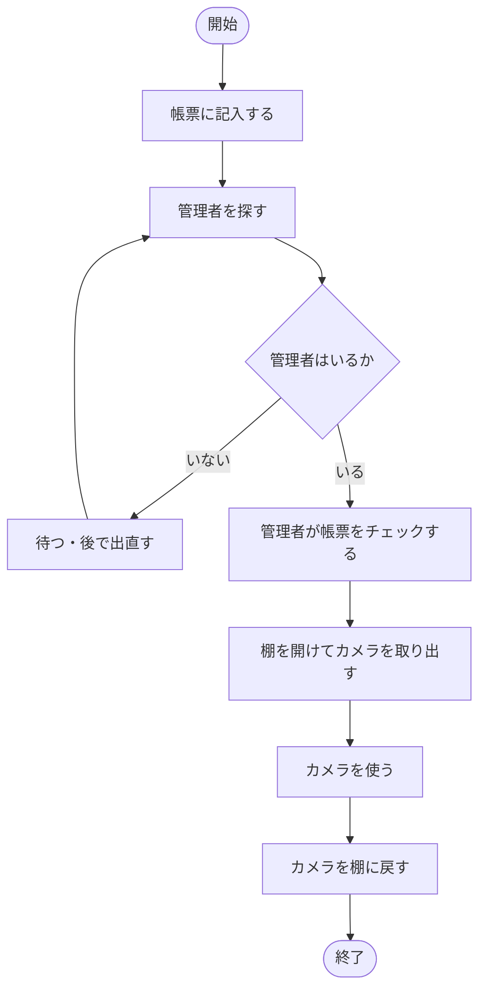
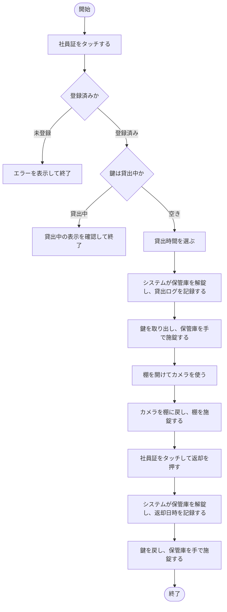
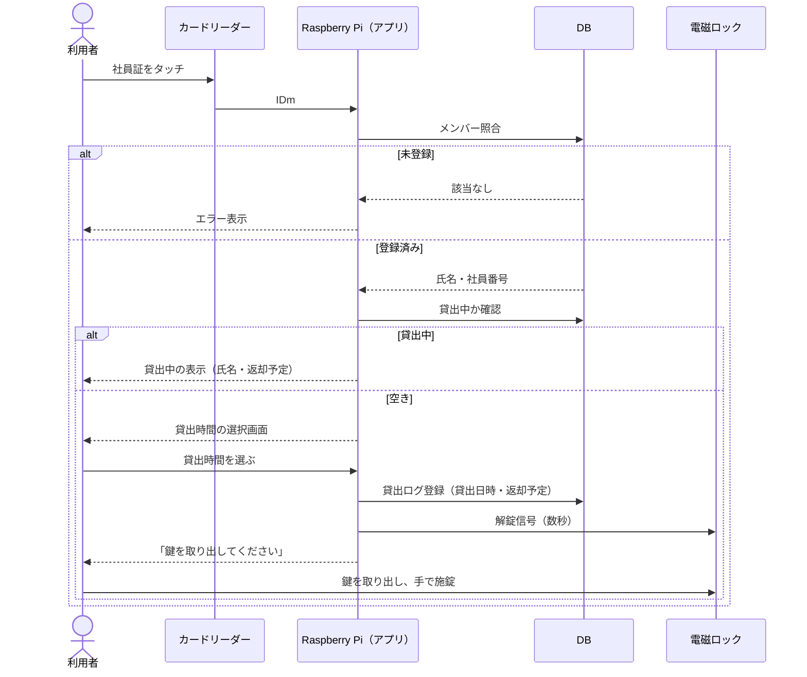
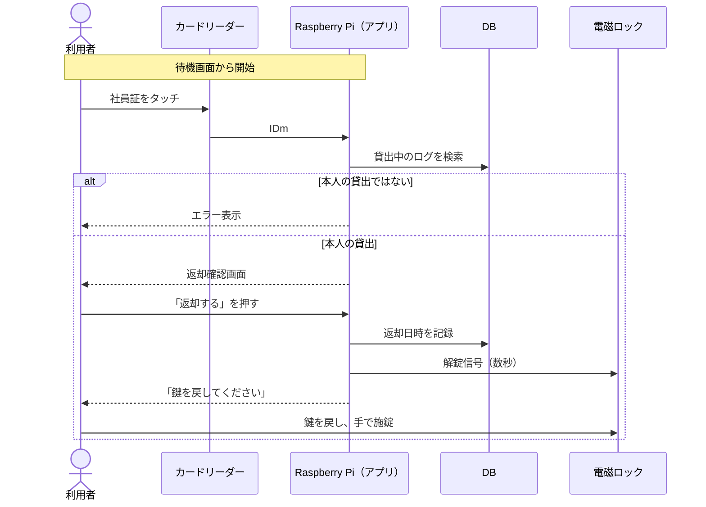
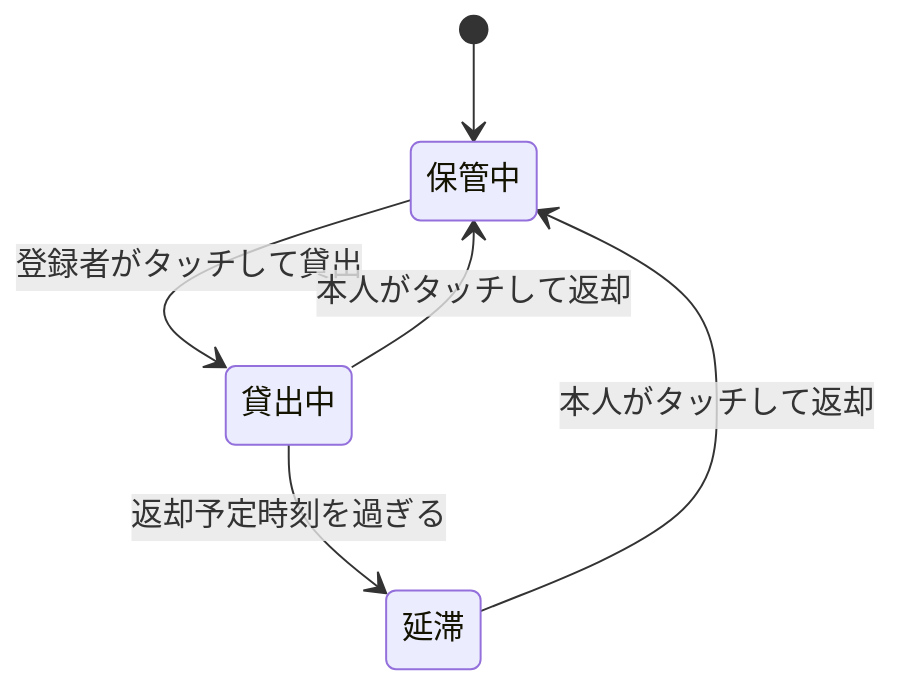
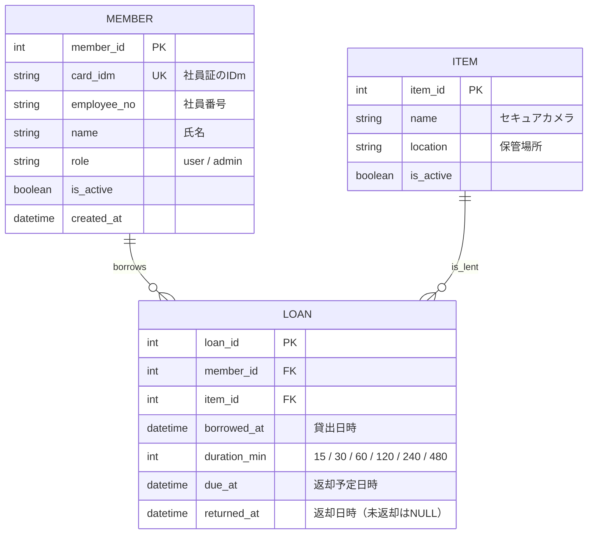
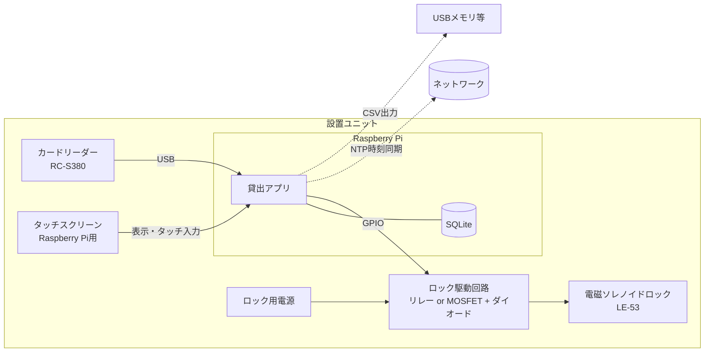
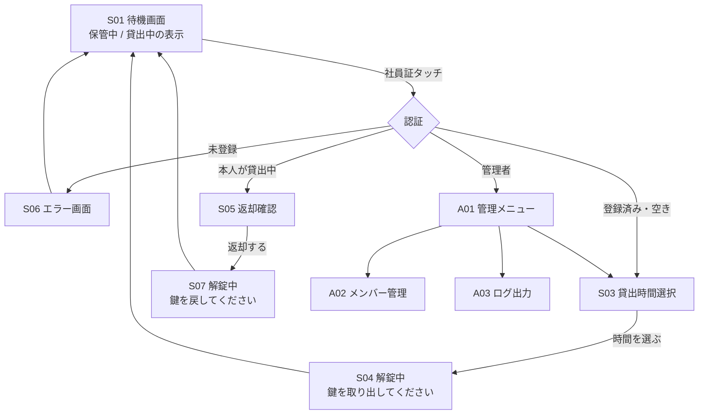

# セキュアカメラ貸出システム 初回ミーティング資料

2026年11月5日 · @ootomonaiso

---

## 1. 概要

セキュアカメラの貸出を、紙の帳票と管理者チェックから「社員証タッチで鍵を借りる」方式に置き換えます。

**依頼の目的：** セキュアカメラ貸出フローの改善

### 現状のフロー

1. 借りたい人が帳票に記入する
2. 借りたい人が管理者に帳票チェックを依頼する
3. 棚を開けてカメラを取り出し、使い終わったら返す

### 現状の課題

| # | 課題 | 影響 |
|---|------|------|
| 1 | 帳票を書くこと自体が面倒 | 記入漏れ・記入の形骸化 |
| 2 | 管理者が不在だと借りられない | 業務が止まる |
| 3 | 管理者を探す手間がかかる | 貸出がスムーズでない |

---

## 2. 決定事項

依頼者とすでに合意できている内容です。ミーティングでは確認だけ行います。

| # | 区分 | 決定内容 |
|---|------|----------|
| D1 | 認証 | 社員証をカードリーダーにタッチして利用する。未登録の社員証は拒否する |
| D2 | 利用者 | 登録されているメンバーのみ利用できる |
| D3 | 貸出 | 貸出システムで鍵を借り、棚を開けてカメラを取り出す |
| D4 | 貸出時間 | 15分 / 30分 / 1時間 / 2時間 / 4時間 / 8時間 から選ぶ |
| D5 | 承認 | 管理者のチェックは省略してよい（管理者の了解済み） |
| D6 | 記録 | 帳票の代わりに、誰がいつ借りていつ返したかの貸借ログを残す |
| D7 | 鍵の運用 | 鍵は使用のたびに保管庫へ戻す |
| D8 | 施錠 | 鍵を返却したあとの施錠は人の手で行う（システムは解錠のみ担当） |
| D9 | 対象物品 | 現時点ではセキュアカメラのみ（複数物品のニーズはある） |
| D10 | ハードウェア | Raspberry Pi、Raspberry Pi用タッチスクリーン、カードリーダー（RC-S380）、電磁ソレノイドロック（LE-53）、ロック駆動回路 |

---

## 3. 検討事項

開発側で検討した提案です。ミーティングでは、各項目について提案どおりでよいかを確認します。

### 3-1. 提案（こちらの案で進めたい事項）

| # | 論点 | 提案 | 理由 |
|---|------|------|------|
| P1 | 返却の記録方法 | 返却時にも社員証をタッチし、「返却」を押して解錠・鍵を戻す | タッチしないと返却日時が記録できない。保管庫を開けるためにも解錠が必要 |
| P2 | 解錠時間 | 解錠信号は数秒のみ出し、その後は通電しない | 施錠が人力のため、通電しっぱなしにする必要がない。コイルの発熱も防げる |
| P3 | 同時貸出 | 鍵が1本のため、貸出中は他の人は借りられない。画面に「貸出中：氏名・返却予定時刻」を表示する | 次に使いたい人が状況を把握できる |
| P4 | 利用者の識別 | 社員証のIDm（カード固有ID）で識別し、氏名・社員番号はシステム側に登録する | 社員証内部のデータを読む必要がなく、実装が単純になる |
| P5 | ログの形式 | 帳票と同じ項目でCSV出力する。日時は `YYYY/MM/DD hh:mm` 形式 | 既存の帳票運用からの移行が楽になる |
| P6 | 複数物品への備え | 今回はカメラのみ実装し、データ設計だけ物品テーブルを持たせておく | 将来の拡張時に作り直しを避けられる |
| P7 | 時刻の正確さ | NTPで時刻同期する（ネットワークがない場合はRTCモジュールを追加） | Raspberry Piは標準で時計用電池を持たず、ログの日時がずれるおそれがある |

### 3-2. 確認したい事項（依頼者に決めてもらう事項）

- [ ] ログに残す利用者情報は、氏名・社員番号のどちらか、または両方か
- [ ] 帳票と同じ形式での出力が必要か
- [ ] メンバー登録は誰が、どのように行うか（管理者画面が必要か）
- [ ] 借用者情報の公開範囲（貸出中に氏名を画面に表示してよいか）
- [ ] 返却予定時刻を過ぎた場合の扱い（通知の要否、通知先）
- [ ] 管理者自身が借りる場合も同じ流れでよいか
- [ ] 停電・故障時に鍵を取り出す手段（予備鍵の保管者）
- [ ] 設置場所のネットワーク環境（有線・Wi-Fi・なし）
- [ ] ログの保管期間と、ログを閲覧できる人
- [ ] 社員証の方式（FeliCaかどうか）

---

## 4. 業務フロー

改善後は管理者がフローから外れ、利用者だけで貸出から返却まで完結します。

### 4-1. 現状（As-Is）

### 4-2. 改善後（To-Be）

大きく変わる点は、帳票の記入と管理者のチェックがなくなり、記録がシステムに置き換わることです。

---

## 5. ユースケース図

利用者のユースケースは「借りる」「返す」「状況を見る」の3つで、管理者は登録とログ確認を担当します。

```mermaid
flowchart LR
  U((利用者))
  M((管理者))
  S[[電磁ロック]]
  subgraph SYS[貸出システム]
    UC1([社員証で認証する])
    UC2([鍵を借りる])
    UC3([鍵を返す])
    UC4([貸出状況を確認する])
    UC5([メンバーを登録・削除する])
    UC6([貸借ログを閲覧・出力する])
    UC7([保管庫を解錠する])
  end
  U --- UC2
  U --- UC3
  U --- UC4
  M --- UC5
  M --- UC6
  M --- UC2
  UC2 -. include .-> UC1
  UC3 -. include .-> UC1
  UC2 -. include .-> UC7
  UC3 -. include .-> UC7
  UC7 --- S
```

| ID | ユースケース | アクター | 概要 |
|----|------------|---------|------|
| UC1 | 社員証で認証する | 利用者・管理者 | IDmを読み取り、登録メンバーか判定する |
| UC2 | 鍵を借りる | 利用者・管理者 | 貸出時間を選び、解錠して貸出ログを記録する |
| UC3 | 鍵を返す | 利用者・管理者 | 解錠して返却日時を記録する |
| UC4 | 貸出状況を確認する | 利用者 | 貸出中の人と返却予定時刻を見る |
| UC5 | メンバーを登録・削除する | 管理者 | 社員証と氏名・社員番号をひも付ける |
| UC6 | 貸借ログを閲覧・出力する | 管理者 | 帳票の代わりとしてCSVで出力する |
| UC7 | 保管庫を解錠する | システム | ソレノイドに数秒通電する |

管理者自身の貸出もUC2で扱う想定です（確認事項）。

---

## 6. シーケンス図

貸出と返却はどちらも「タッチ → 照合 → 解錠 → ログ記録」の同じ流れで、違いはログの書き込み先だけです。

### 6-1. 貸出

### 6-2. 返却

本人以外による返却を認めるかどうかは、管理者の運用に合わせて決めます。

---

## 7. 状態遷移図

物品の状態は「保管中」「貸出中」「延滞」の3つです。返却予定時刻を過ぎると延滞になります。

延滞時の通知を入れるかどうかは確認事項です。

---

## 8. ER図

テーブルはメンバー・物品・貸借ログの3つで、貸借ログが帳票1行に当たります。

| テーブル | 役割 | 補足 |
|----------|------|------|
| MEMBER | 利用できる人の一覧 | `card_idm` を一意にして、未登録の社員証をはじく |
| ITEM | 貸出対象の物品 | 今はカメラ1件のみ。複数物品になっても構造は変えない |
| LOAN | 貸借ログ | `returned_at` が NULL の行 = 貸出中。CSV出力の元データ |

「貸出中か」は LOAN の `returned_at` が NULL の行の有無で判定するため、状態を別に持つ必要はありません。

---

## 9. システム構成図

Raspberry Pi 1台にカードリーダー、タッチスクリーン、ロック駆動回路をつなぐスタンドアロン構成です。

| 構成要素 | 役割 | 要確認 |
|----------|------|--------|
| カードリーダー（RC-S380） | 社員証のIDmを読み取る | nfcpyで社員証が読めるか |
| タッチスクリーン | 操作画面の表示と入力 | 解像度に合わせた画面設計 |
| Raspberry Pi | アプリとDBを動かす | 機種、OS |
| ロック駆動回路 | GPIOの信号でロックに電流を流す | ロックの定格電圧・電流に合う部品選定 |
| 電磁ソレノイドロック（LE-53） | 保管庫を解錠する | 通電時解錠か、通電時施錠か |
| ロック用電源 | ロックを動かす電源 | Raspberry Piと電源を分けるか |

アプリはPython（nfcpy + GUI）、DBはSQLiteを想定しています。

---

## 10. 機能一覧とフェーズ

フェーズ1で帳票と管理者チェックを置き換え、フェーズ2で複数物品と通知に広げます。

| ID | 機能 | 概要 | フェーズ |
|----|------|------|:--------:|
| F01 | 社員証認証 | IDmを読み取り、登録メンバーか判定する | 1 |
| F02 | 貸出 | 貸出時間を選び、ログを記録して解錠する | 1 |
| F03 | 返却 | 本人確認のうえ返却日時を記録して解錠する | 1 |
| F04 | 貸出状況表示 | 待機画面に保管中 / 貸出中（氏名・返却予定）を表示する | 1 |
| F05 | 解錠制御 | GPIOでソレノイドに数秒通電する | 1 |
| F06 | メンバー管理 | 社員証のタッチで登録、氏名・社員番号を入力、削除・無効化 | 1 |
| F07 | 貸借ログ出力 | 帳票と同じ項目でCSV出力する | 1 |
| F08 | 管理者認証 | 管理者の社員証タッチで管理画面に入る | 1 |
| F09 | 延滞表示 | 返却予定を過ぎたら待機画面で強調する | 1 |
| F10 | 延滞通知 | メールやチャットで本人・管理者に知らせる | 2 |
| F11 | 複数物品対応 | 物品ごとに貸出・返却・ロックを分ける | 2 |
| F12 | ログ閲覧（Web） | 管理者がPCのブラウザからログを見る | 2 |

フェーズ1の範囲は、確認事項の回答しだいで調整します。

---

## 11. 画面一覧と画面遷移

利用者向けは6画面、管理者向けは3画面です。待機画面から始まり、一定時間操作がなければ待機画面に戻ります。

| ID | 画面 | 主な表示・操作 |
|----|------|----------------|
| S01 | 待機画面 | 「社員証をタッチしてください」、物品の状態、貸出中なら氏名と返却予定 |
| S03 | 貸出時間選択 | 15分 / 30分 / 1時間 / 2時間 / 4時間 / 8時間 の大きなボタン、キャンセル |
| S04 | 解錠中（貸出） | 「鍵を取り出し、扉を閉めてください」、返却予定時刻 |
| S05 | 返却確認 | 貸出日時、「返却する」ボタン |
| S06 | エラー | 未登録・他人が貸出中などの理由 |
| S07 | 解錠中（返却） | 「鍵を戻し、扉を閉めてください」 |
| A01 | 管理メニュー | メンバー管理、ログ出力、自分で借りる |
| A02 | メンバー管理 | 社員証タッチで登録、氏名・社員番号の入力、無効化 |
| A03 | ログ出力 | 期間を選んでCSVを書き出す |

タッチスクリーンで指で押すため、ボタンは大きく、1画面1操作にします。返却は「本人が貸出中ならタッチだけで返却確認へ進む」流れにすると、ボタンを1つ減らせます。

---

## 12. 発表資料の構成案

初回ミーティングは「決定事項の確認 → 提案への合意 → 確認事項の回答」の順で進め、最後に宿題を決めます。全11枚、20〜30分を想定しています。

| # | スライド | 載せる内容 | 話すこと |
|---|----------|-----------|----------|
| 1 | 表紙 | タイトル、日付、発表者 | 本日の目的は「要件のすり合わせ」 |
| 2 | 本日のゴール | 決定事項の確認、提案への合意、確認事項の回答 | 最後に宿題と次回日程を決めたい |
| 3 | 背景と課題 | 1章の課題表 | 帳票が面倒、管理者不在で借りられない |
| 4 | 業務フロー（現状 → 改善後） | 4章の2つのフロー図を左右に並べる | 管理者がフローから外れ、記録はシステムが担う |
| 5 | 決定事項 | 2章の表 | 認識違いがないかだけ確認する |
| 6 | システム構成 | 9章の構成図 | 使う機器と、施錠は人の手で行う点 |
| 7 | 画面と操作の流れ | 11章の画面遷移図（可能なら画面ラフ） | 貸出・返却それぞれ何タッチで終わるか |
| 8 | データとログ | 8章のER図を簡略化、CSVの出力例 | 帳票と同じ項目が残ること |
| 9 | 提案事項 | 3-1の表 | 一つずつ合意を取る（特にP1返却タッチ、P4 IDm識別） |
| 10 | 確認したい事項 | 3-2のチェックリスト | その場で回答をもらい、未回答は宿題にする |
| 11 | スケジュールと次のアクション | 13章の日程、宿題の担当と期限 | 次回の確認日を決める |

ER図・シーケンス図・状態遷移図は、依頼者には詳しすぎる可能性があります。本編は構成図と画面遷移までにとどめ、残りは付録にするのがおすすめです。

---

## 13. 11日までのスケジュール

ハードの動作確認を早めに済ませ、部品の追加注文が必要になった場合の時間を確保します。

| 日付 | 作業 |
|------|------|
| 11/5（木） | 本資料の確定、確認事項の送付、部品の仕様確認（LE-53の定格、駆動回路） |
| 11/6（金） | 初回ミーティング資料の作成、カードリーダーで社員証のIDmが読めるか確認 |
| 11/7（土）〜8（日） | ロック駆動回路の作成と解錠テスト、DB・認証・貸出ロジックの実装 |
| 11/9（月） | 画面の実装、返却・ログ出力・メンバー管理の実装 |
| 11/10（火） | 結合テスト（タッチ → 解錠 → ログ記録の通し）、不具合修正 |
| 11/11（水） | 最終確認、納品 |

- [ ] 初回ミーティングの日程を決める
- [ ] 確認事項を依頼者へ送る
- [ ] LE-53の定格電圧・電流と、通電時の動作（解錠か施錠か）を確認する
- [ ] 社員証がRC-S380で読めるか試す
